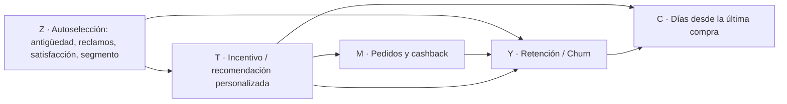

# 📓 BITÁCORA DE INGENIERÍA — Decision Intelligence Capstone

> Cuaderno de laboratorio y registro de decisiones (no es un resumen del notebook ni un log de commits).
> **Proyecto:** Retorno causal de un motor de recomendaciones / incentivo personalizado sobre la retención · EAyMR 2026 · UCA
> **Formato de cada registro:** `[AAAA-MM-DD HH:MM] · Autor (Rol) · Decisión · Evidencia · Alternativas descartadas`

| Rol | Integrante | Firma |
|---|---|---|
| 👑 Project Lead & Scrum Master (PO) | **Carola Nasif** | ☐ |
| ⚙️ Backend & ML / Causal Engineer | **Julián Agustín Lozano** | ☐ |
| 🎨 Frontend & UI/UX Engineer | **Emilia Mortarini** | ☐ |
| 🔍 QA & Validation Engineer | **Emilia Mortarini** (co-auditoría cruzada con Carola Nasif) | ☐ |

---

## Entrada 1 — Marco Estratégico e Hipótesis
**Responsable:** Project Lead · **Estado:** 🟢 CERRADA v1.0 (2026-11-12 21:00)

### 1.1 Problema de negocio
Las plataformas de e-commerce asignan cupones, cashback y recomendaciones personalizadas (generadas por un motor de recomendación / CRM) con el objetivo de retener clientes. Los dashboards muestran que **los clientes que usan incentivos churnean menos**, y la dirección concluye que "los cupones retienen". Pero esa correlación está contaminada por **autoselección**: los usuarios recurrentes, antiguos y comprometidos son, a la vez, los que más usan incentivos y los que menos abandonan. Si la empresa escala la política sobre esa correlación, puede estar **regalando margen a clientes que se iban a quedar igual** ("sure things") y no alcanzando a los "persuadibles".

### 1.2 Preguntas fundacionales
1. **Predictiva — $P(Y \mid X)$:** ¿Qué clientes tienen alta probabilidad de churn el próximo período, y qué tan bien calibradas están esas probabilidades?
2. **Causal — $P(Y \mid do(T=t))$:** ¿Cuál es el efecto causal promedio (ATE) del incentivo $T$ sobre la retención $Y$ una vez bloqueados los caminos de puerta trasera por $Z$?
3. **Heterogeneidad — CATE $\tau(x)$:** ¿En qué segmentos (antigüedad, ciudad, categoría, reclamo previo) el incentivo es costo-efectivo y en cuáles es neutro o contraproducente?
4. **Choque:** ¿La variable más predictiva del churn es una palanca accionable?

### 1.3 Hipótesis de trabajo (a contrastar)
- **H-causal-1:** el ATE ajustado del incentivo sobre el churn es negativo (protege) pero de **menor magnitud** que la asociación ingenua (sesgo de autoselección por `Tenure`).
- **H-causal-2:** el sesgo puede invertir su signo por **cupones compensatorios** otorgados tras un reclamo (`Complain` como confusor).
- **H-predictiva-1:** las variables top del Random Forest (`Tenure`, `DaySinceLastOrder`, `Complain`) no coinciden con las palancas causales.
- **H-inferencial-1:** el cashback medio difiere entre clientes que churnean y que no (Welch t, Cohen's d).
- **H-inferencial-2:** el cashback medio difiere entre categorías de producto preferidas (ANOVA / Welch / Kruskal).

### 1.4 Mapa conceptual

### 1.5 Selección fundamentada del dataset
- Candidatos evaluados: **A** E-Commerce Customer Churn (Kaggle, N=5.630, 18 explicativas) · **B** Olist (≈96k clientes, 9 tablas) · **C** Lenta Uplift (687k, RCT). Detalle y matriz ponderada en [`docs/01_propuestas_datasets_y_dags.md`](docs/01_propuestas_datasets_y_dags.md).
- **Propuesta del PL:** Opción A (puntaje 4,50/5) por tener T, Y, Z, M y C **observables** en una sola tabla, 7 columnas con faltantes reales y viabilidad en 72 hs.
- **Decisión del equipo:** ☑ A ☐ B ☐ C — fecha/hora: 2026-11-12 21:00 — votos: 3/3 (unánime: Carola Nasif, Julián Agustín Lozano, Emilia Mortarini)
- Procedencia, licencia y hash SHA-256 del archivo crudo: Kaggle (`ankitverma2010/ecommerce-customer-churn-analysis-and-prediction`, archivo `E Commerce Dataset.xlsx`, hoja `E Comm`) · licencia pública de dataset Kaggle (uso académico/no comercial) · SHA-256: `db70f1e34bc5326887ea3fb3d2a0854e82c577d55ef3a76fdfb25328631bd44d`
- Amenaza reconocida desde el día 0: procedencia corporativa anónima y corte transversal (orden temporal de T, M, C e Y asumido, no observado).

### 1.6 Criterios de éxito
Notebook "Restart & Run All" sin errores · ATE con IC 95% y 3 refutaciones en verde · App pública con 3 módulos · Quality Gate en verde en `main` · Rúbrica autoevaluada ≥ 90.

---

## Entrada 2 — Matriz de Decisiones Estadísticas y Supuestos
**Responsable:** QA + Project Lead · **Estado:** 🟡 Fase 1 completa (Carola Nasif · pendiente Fase 2 por QA y Fase 4 por ML)

| # | Fase | Supuesto / decisión | Test / evidencia | Resultado (estadístico, p) | Violación | Remediación elegida | Alternativa descartada y por qué |
|---|---|---|---|---|---|---|---|
| 1 | F1 | α a priori | — | α = 0,05 | — | Fijado antes del análisis; se reporta p exacto y magnitud | α = 0,01 (reduciría potencia innecesariamente) |
| 2 | F1 | Mecanismo de NA en las 7 columnas con faltantes (4,14%–5,68% en N=5.073) | Test de Little (EM) + logit indicador NA + χ² vs Churn | Little d²=4860,78 (gl=77, p<1e-300); logit MAR AUC=0,911–0,996 (p_LRT<1e-90); χ² vs Churn p≤0,031 en 6/7 (DaySinceLastOrder p=0,391) | Sí (no es MCAR) | Imputación por mediana/moda + indicador binario de NA dentro del Pipeline (fit solo en Train); T=`coupon_any` preserva NA | Eliminación por lista (sesgo bajo MAR) o imputación previa al split (leakage) |
| 3 | F1 | Normalidad por grupo (ANOVA `CashbackAmount ~ PreferedOrderCat`) | asimetría, curtosis, Q-Q (Shapiro solo informativo) | Fashion (skew 0,08; kurt -0,35; Shapiro p=1,79e-6) y Others (-0,10; -1,45; p=7,03e-11) simétricos; Laptop (-0,92; 8,51), Mobile (-0,66; 4,70) y Grocery (-3,56; 28,73) con colas/curtosis | Sí (Grocery, Laptop y Mobile exceden \|kurt\|≤2; Shapiro rechaza en los 5 por N grande) | Decisión por asimetría/curtosis + Q-Q; Kruskal-Wallis (H=3698,33, p<1e-300, ε²=0,729) como no paramétrico y Welch ANOVA como robusto de medias | Decidir por Shapiro-Wilk (hipersensible con N=5.073) o usar solo ANOVA clásico |
| 4 | F1 | Homocedasticidad (`CashbackAmount ~ PreferedOrderCat`) | Levene (center=median) + ratio var_max/var_min | Levene=36,61 (p=3,25e-30); ratio var_max/var_min=4,82 | Sí (heterocedasticidad) | Welch ANOVA (F=9492,58, gl1=4, gl2=1063,20, p<1e-300) y Kruskal-Wallis (H=3698,33, p<1e-300, η²=0,841, ω²=0,841); se rechaza H0 | ANOVA clásico de Fisher sin ajuste (asume varianzas iguales; queda solo como referencia) |
| 5 | F1 | Control FWER post-hoc (k=5 grupos, m=10 pares, FWER sin ajuste=40,13%) | Tukey HSD / Games-Howell / Bonferroni | 10/10 pares rechazan H0 en Games-Howell (p_adj≤1,44e-13), Tukey HSD (p_adj=4,16e-12) y Bonferroni (p_adj≤2,25e-66) | No (controlado) | Games-Howell (heterocedástico) + Bonferroni (no paramétrico) y Tukey HSD como contraste | 10 comparaciones sin corrección (inflaría FWER a 40,13%) |
| 6 | F2 | Homocedasticidad MCO | Breusch-Pagan / White | | | HC3 | |
| 7 | F2 | Normalidad residuos | Jarque-Bera + Q-Q | | | | |
| 8 | F2 | Independencia | Durbin-Watson (aclarar orden de filas) | | | | |
| 9 | F2 | Influyentes | Cook > 4/n, h > 2(p+1)/n, \|r\| > 3 | | | Huber / RANSAC | |
| 10 | F2 | Multicolinealidad | VIF > 5 / > 10 | | | | |
| 11 | F2 | PCA: nº de componentes | Kaiser vs codo vs 80% | | | | |
| 12 | F4 | Positividad / overlap | histograma de propensity, trimming | | | | |
| 13 | F4 | Balance post-IPW | SMD < 0,1 | | | | |

### 2.1 Resumen de contrastes formales y potencia (Fase 1, `make_clean_dataset()`, N = 5.073; consistentes en Train N = 4.058)
- **Contraste 1 (`CashbackAmount` según `Churn`):** `Churn=1` (n=841, media \$161,78, DE 39,02) vs `Churn=0` (n=4.232, media \$180,80, DE 50,62). Diferencia = −\$19,02 (IC 95% analítico [−22,07; −15,97], bootstrap 5.000 réplicas [−22,01; −16,03]). Welch $t = -12,24$ ($\text{gl}=1463,28$, $p = 7,35 \times 10^{-33}$), Mann-Whitney $U = 1.344.932,5$ ($p = 3,92 \times 10^{-29}$), Cohen's $d = -0,3891$ (efecto pequeño). Se rechaza $H_0$. **Potencia (`TTestIndPower`):** $1-\beta = 1,0000$; tamaño de efecto mínimo detectable al 80% de potencia: $d_{\min} = 0,1058$. *(En Train N=4.058: diff = −\$18,94, $t = -10,66$, $p = 2,18 \times 10^{-25}$, $d = -0,3833$, potencia = 1,0000).*
- **Contraste 2 (`Complain` vs `Churn`):** tasa de churn con reclamo = 31,31% (449/1.434) vs sin reclamo = 10,77% (392/3.639); diferencia = +20,54 pp (IC 95% [+17,94 pp; +23,14 pp]), $\chi^2 = 313,77$ ($\text{gl}=1$, $p = 3,30 \times 10^{-70}$), $V$ de Cramér $= 0,2487$, OR $= 3,78$. Se rechaza $H_0$. *(En Train N=4.058: diff = +21,19 pp, $\chi^2 = 265,67$, $p = 9,98 \times 10^{-60}$, $V = 0,2559$).*

---

## Entrada 3 — Autopsia de Experimentos Fallidos (Data Autopsy)
**Responsable:** Backend & ML + QA · **Estado:** ⬜ pendiente (sábado 14/11) · **Mínimo: 2 experimentos**

### Experimento fallido #1 — _título_
- **Hipótesis / qué intentamos:**
- **Qué pasó (evidencia numérica y figura):**
- **Diagnóstico de la causa:**
- **Qué aprendimos:**
- **Corrección aplicada y resultado:**

### Experimento fallido #2 — _título_
- (misma estructura)

> Candidatos probables: árbol CART sin podar (AUC Train≈1 vs Test), Naive Bayes descalibrado por dependencia `OrderCount`–`CouponUsed`, logística inestable por VIF alto, ATE "inflado" al incluir el colisionador.

---

## Entrada 4 — Formalización del Debate Causal
**Responsable:** Backend & ML / Causal + Project Lead · **Estado:** ⬜ pendiente (sábado 14/11)

### 4.1 Justificación arco por arco
| Arco | Mecanismo de dominio | Temporalidad | Confianza (alta/media/baja) |
|---|---|---|---|
| `Tenure → T` | | | |
| `Tenure → Y` | | | |
| `Complain → T` | | | |
| `T → OrderCount → Y` | | | |
| `T → DaySinceLastOrder ← Y` | | | |

### 4.2 Variables latentes no observadas
- U_engagement (afinidad con la marca): ¿afecta T e Y? Plausibilidad, dirección del sesgo esperado y análisis de sensibilidad (`add_unobserved_common_cause`).

### 4.3 Amenazas a la validez interna
- Confusión residual · causalidad inversa · SUTVA (interferencia entre clientes) · error de medición en T ("usó" vs "recibió") · positividad · selección muestral.

### 4.4 Resultados y refutaciones
| Estimador | ATE | IC 95% | Comentario |
|---|---|---|---|
| Ingenuo Y ~ T | | | |
| Backdoor regresión lineal | | | |
| IPW | | | |
| LinearDML | | | |
| Con M incluido (trampa) | | | |
| Con C incluido (trampa) | | | |

| Refutador | Resultado | Semáforo |
|---|---|---|
| Random Common Cause | | |
| Placebo Treatment | | |
| Data Subset | | |

---

## Entrada 5 — Trazabilidad y Uso Ético de Asistentes de IA
**Responsable:** QA & Validation Engineer (con aportes de todos) · **Estado:** 🟢 abierta (registro vivo)

**Política del equipo:** la IA se usa como *tutor y acelerador*, nunca como fuente de verdad. Toda afirmación numérica o de API generada por IA se verifica contra (a) los datos, (b) la documentación oficial o (c) un test determinístico antes de entrar a `main`.

### Registro de sesiones

#### Sesión IA-01 · 2026-11-12 17:30 · Diseño arquitectónico (Sprint 0)
- **Herramienta:** Google Antigravity (agente de IA con acceso al workspace) · modelo Claude Opus.
- **Operador:** Carola Nasif (Project Lead)
- **Equipo registrado:** Carola Nasif, Julián Agustín Lozano, Emilia Mortarini (3 integrantes).
- **Prompt utilizado (resumen fiel):**
  > "Actuá como Principal Data Scientist, Arquitecto de Software y Tutor Metodológico para nuestro TPI 'Decision Intelligence Capstone' (EAyMR, UCA 2026). REGLA CRÍTICA: todavía NO escribas código de modelado, notebooks ni la app. [Contexto: entrega técnica dom 15/11 23:59, defensa mié 18/11, 4 roles Scrum, tema 'Retorno causal de algoritmo de recomendación', requisitos del dataset y rúbrica de 5 fases]. Tareas: (1) proponer 3 datasets reales de e-commerce/recomendación con roles T, Y, Z, M, C; (2) crear la estructura de carpetas `/src`, `/data`, `/notebooks`, `/app`, `/tests` con esqueletos, `README.md` y `requirements.txt`; (3) crear en `/docs` las propuestas de datasets y DAGs, la guía metodológica paso a paso y el plan Scrum de 72 hs; crear `BITACORA.md` con las 5 entradas, la Entrada 1 redactada y esta sesión registrada en la Entrada 5."
  > Insumos adjuntos: `Enunciado_TP_Integrador_EAyMR_2026.pdf`, `Rubrica_Evaluacion_TP_Integrador.pdf`, captura de la *Rúbrica complementaria* y PDF "Dataset TPI" del aula virtual EVA.
- **Artefactos generados:** estructura del repo, esqueletos `src/*.py` (solo firmas + `NotImplementedError`), `app/app.py` (layout sin lógica), `tests/test_quality_gate.py`, `docs/01-03`, este archivo.
- **Discrepancias detectadas entre el prompt y los documentos oficiales (verificadas por la IA contra los PDF):**
  1. El prompt agrupa "Fase 5 = 25 pts"; la Rúbrica Detallada lo separa en **D5 Scrum/Bitácora (10 pts) + D6 Deploy/Código/Defensa (15 pts)**. La suma coincide, pero se adopta el desglose oficial.
  2. El enunciado fija la **entrega oficial el miércoles 18/11 23:59** (EVA); el domingo 15/11 es un *code freeze* interno del equipo, no la fecha de la cátedra.
  3. La defensa dura **12-15 minutos** (enunciado), dato que el prompt no explicitaba.
- **Afirmaciones de la IA que el equipo DEBE verificar (posibles alucinaciones):**

| # | Afirmación generada | Cómo se verifica | Responsable | Estado |
|---|---|---|---|---|
| V1 | Dataset A: 5.630 filas, 20 columnas, ≈17% churn, ~4-6% NA en 7 columnas | `df.shape`, `df.isna().mean()`, `df.Churn.mean()` + `test_real_dataset_dimensions` | QA | ✅ 5.630 × 20 · churn 16,84% · NA 4,46-5,45% en las 7 columnas citadas (Sesión IA-03) |
| V2 | Dataset A tiene categorías duplicadas (`Phone`/`Mobile Phone`, `CC`/`Credit Card`, `COD`) | `value_counts()` | PL | ⚠️ correcta pero incompleta: faltaba `Mobile`/`Mobile Phone` en `PreferedOrderCat` (Sesión IA-03) |
| V3 | Olist: voucher ≈5% de pagos, recompra ≈3%, `review_comment_message` ≈58% vacío | conteos sobre las tablas | PL | ☐ |
| V4 | Lenta: 687.029 × 193 + `group` + `response_att`; nombres de columnas citados (`response_sms`, etc.) | `fetch_lenta().data.columns` | ML | ☐ |
| V5 | APIs: `CausalModel`, `identify_effect`, métodos `backdoor.linear_regression` / `backdoor.propensity_score_weighting`, refutadores `random_common_cause` / `placebo_treatment_refuter` / `data_subset_refuter`; `LinearDML`, `CausalForestDML` | Docs oficiales de DoWhy/EconML en la versión instalada + smoke test | ML | ☐ |
| V6 | Rangos de versiones de `requirements.txt` compatibles entre sí | `pip install` limpio + `pytest` | QA | ❌ → ✅ corregido (ver Sesión IA-02) |
| V7 | Argumento de hipersensibilidad de Shapiro-Wilk y sesgo MDI (Strobl et al., 2007) | Cita bibliográfica + experimento con columna de ruido | ML | ☐ |
| V8 | Signo del sesgo de confusión esperado (H-causal-1/2) | Es una **hipótesis**, no un resultado: se contrasta en Fase 4 | ML | ☐ |

- **Pruebas determinísticas creadas para neutralizar errores de IA:** `tests/test_quality_gate.py` (split 80/20 disjunto y estratificado, escalador y PCA ajustados solo en Train, N ≥ 1.500 y ≥ 10 explicativas, M y C fuera del set de ajuste).
- **Errores / alucinaciones detectadas en esta sesión:** _completar por el equipo tras la verificación V1-V8_.

#### Sesión IA-02 · 2026-11-14 14:47 · Entorno reproducible y verificación V6
- **Herramienta:** Claude Code (Claude Opus 5.5), con acceso al repositorio local.
- **Operador:** Julián Agustín Lozano (Backend & ML / Causal Engineer).
- **Prompt (resumen fiel):** "Cloná el repo e instalá lo que falte." Luego: "Fijá las versiones en `requirements.txt` en una rama aparte con PR."
- **Qué se hizo:** entorno con Python 3.11 (vía `uv`) e instalación limpia de `requirements.txt`, seguida de un smoke test de DoWhy y EconML sobre datos sintéticos con ATE verdadero = 2.
- **Error detectado (alucinación de la Sesión IA-01, punto V6):** los rangos abiertos de `requirements.txt` resolvían a versiones incompatibles entre sí:
  1. `networkx 3.6` eliminó `nx.algorithms.d_separated`, que `dowhy 0.12` usa en `identify_effect` → `AttributeError`.
  2. `pandas 3.1` rompe la indexación posicional que usa `dowhy 0.12` en `backdoor.linear_regression` → `KeyError: 0`.
- **Corrección:** `pandas>=2.1,<3` y `networkx>=3.1,<3.5`. Con eso: ingenuo 5,35 · regresión 2,08 · IPW 2,29 · LinearDML 2,04 · placebo 0,007 · random common cause 2,08 · data subset 2,07.
- **Qué se aceptó:** los pines de versión y el smoke test. **Qué se rechazó:** subir a `dowhy 0.14` (obligaba a bajar `scipy` y no se había probado con el resto del stack).
- **Test asociado:** `tests/test_causal_stack.py` (DoWhy backdoor y EconML LinearDML deben recuperar ATE = 2 ± 0,3; el ingenuo debe estar sesgado).

#### Sesión IA-03 · 2026-11-14 15:10 · Carga, limpieza, contrato de datos y split
- **Herramienta:** Claude Code (Claude Opus 5.5), con acceso al repositorio local.
- **Operador:** Julián Agustín Lozano (Backend & ML / Causal Engineer).
- **Prompt (resumen fiel):** "Arrancá con la carga, limpieza y split del dataset A en una rama nueva."
- **Qué se hizo:** `src/preprocessing.py` (contrato T/Y/Z/M/C según `docs/01`, carga, normalización de categorías, eliminación de duplicados, `coupon_any`, split 80/20 estratificado persistido en `artifacts/split_idx.json`, `build_preprocessor`) y `tests/test_preprocessing.py`.
- **Hallazgos sobre el dataset (verificación V1/V2 y auditoría):**
  1. V1 confirmada. V2 incompleta: además de las 3 duplicaciones citadas, `PreferedOrderCat` tiene `Mobile` y `Mobile Phone`.
  2. **No detectado por la IA en la Sesión IA-01:** 556 pares de filas idénticas salvo el `CustomerID`, con IDs separados exactamente por 1470 (p. ej. 51046 ↔ 52516); 557 tras unificar categorías. Sin etiquetas de churn contradictorias. Se interpretan como copias del proceso de generación del dataset.
  3. T = `coupon_any`: 81,25% tratados y 210 NA (de `CouponUsed`) tras la limpieza → la positividad/overlap será crítica en Fase 4.
- **Decisión:** eliminar los duplicados **antes** del split (si no, el mismo cliente puede quedar en Train y en Test: leakage). Antes → después: 5.630 → 5.073 filas; churn 16,84% → 16,58%. Se conserva `load_raw_data(drop_duplicates=False)` para análisis de sensibilidad. Los NA de T no se imputan en el preprocesamiento: se decide en Fase 4.
- **Qué se rechazó:** imputar o binarizar `CouponUsed` con NA = 0 (supone sin evidencia que el faltante significa "no usó cupón").
- **Test asociado:** `tests/test_preprocessing.py` (categorías normalizadas, duplicados eliminados, NA de T preservados, dataset sin imputar, split 80/20 estratificado y disjunto, round-trip del split, preprocesador ajustado solo en Train, categorías nuevas en Test).

#### Sesión IA-04 · 2026-11-14 15:32 · Fase 1: auditoría de faltantes, contrastes formales, potencia y ANOVA
- **Herramienta:** Google Antigravity (agente de IA con acceso al workspace).
- **Operador:** Carola Nasif (Project Lead & Scrum Master).
- **Prompt (resumen fiel):** "Revisión cruzada de PR #1 y #2 sin mergear; cerrar Entrada 1 de BITACORA.md con decisión A y SHA-256; crear milestones e issues por integrante en GitHub; en rama feat/fase1-inferencia (desde feat/preprocesamiento) implementar solo missingness_report en src/preprocessing.py y las 6 funciones de Fase 1 en src/inference.py (sin tocar Fase 2), con tests en tests/test_inference.py y Entrada 2 F1 en la bitácora."
- **Qué se hizo:**
  - `src/preprocessing.py`: `missingness_report` con conteo/% de NA, $\chi^2$ y $V$ de Cramér vs `Churn`, regresión logística del indicador de NA sobre covariables observadas (LRT en `statsmodels` + ROC-AUC en CV estratificada 5-fold) y test global MCAR de Little por algoritmo EM.
  - `src/inference.py`: `cohens_d`, `two_sample_test` (Welch t, IC analítico y bootstrap 5.000 réplicas, Mann-Whitney U, Cohen's d, potencia y MDE con `TTestIndPower`), `chi2_independence` ($\chi^2$, $V$ de Cramér, diferencia de proporciones con IC 95%), `normality_diagnostics` (asimetría, curtosis en exceso, Shapiro/D'Agostino informativos y Q-Q), `one_way_anova_suite` (Levene `center='median'`, ANOVA clásico, Welch ANOVA, Kruskal-Wallis, $\eta^2$, $\omega^2$, $\varepsilon^2$ y árbol de decisión) y `posthoc` (`games-howell`, `tukey`, `bonferroni`).
  - `BITACORA.md`: Entrada 1 cerrada (v1.0, Opción A unánime 3/3, SHA-256 `db70f1e34bc5326887ea3fb3d2a0854e82c577d55ef3a76fdfb25328631bd44d`) y Entrada 2 filas F1 completadas con los resultados reales sobre `make_clean_dataset()`.
- **Errores / incompatibilidades detectadas y corregidas:**
  1. `pingouin 0.6.1` renombró columnas respecto a 0.5.x (`p_unc` en lugar de `p-unc` en `welch_anova`; `p_tukey` en lugar de `p-tukey` y `mean_A`/`mean_B` en lugar de `mean(A)`/`mean(B)` en `pairwise_tukey`/`pairwise_gameshowell`). Se agregó `_pick_col` para compatibilidad con ambas versiones.
  2. La separación casi completa de algunos indicadores de NA producía warnings de convergencia/Hessiano en `statsmodels.Logit`; se aislaron dentro de `warnings.catch_warnings()` usando BFGS primero y respaldando la evidencia MAR con ROC-AUC out-of-fold.
- **Qué se aceptó / qué se rechazó:** Se aceptaron los cálculos exactos en `src/` sin duplicar lógica ni tocar las funciones asignadas a Emilia (Fase 2). Se rechazó cualquier redacción que dijera "se acepta H0", usando estrictamente "Se rechaza H0" / "No se rechaza H0".
- **Test asociado:** `tests/test_inference.py` (tests unitarios con datos sintéticos + verificación de fronteras de rol + integración sobre `make_clean_dataset()`).

#### Sesión IA-05 · _fecha_ · _tema_
- Herramienta / modelo · Operador · Prompt · Qué se aceptó · Qué se rechazó y por qué · Test asociado.
