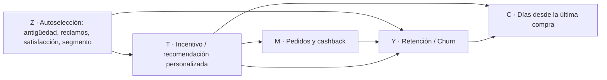

# 📓 BITÁCORA DE INGENIERÍA — Decision Intelligence Capstone

> Cuaderno de laboratorio y registro de decisiones (no es un resumen del notebook ni un log de commits).
> **Proyecto:** Retorno causal de un motor de recomendaciones / incentivo personalizado sobre la retención · EAyMR 2026 · UCA
> **Formato de cada registro:** `[AAAA-MM-DD HH:MM] · Autor (Rol) · Decisión · Evidencia · Alternativas descartadas`

| Rol | Integrante | Firma |
|---|---|---|
| 👑 Project Lead & Scrum Master (PO) | **Carola Nasif** | ☐ |
| ⚙️ Backend & ML / Causal Engineer | **Julián Agustín Lozano** | ☐ |
| 🎨 Frontend & UI/UX Engineer | **Emilia Mortarini** | ☐ |
| 🔍 QA & Validation Engineer | **Emilia Mortarini** (co-auditoría cruzada con Carola Nasif) | ☐ |

---

## Entrada 1 — Marco Estratégico e Hipótesis
**Responsable:** Project Lead · **Estado:** 🟢 CERRADA v1.0 (2026-11-14 15:00)

### 1.1 Problema de negocio
Las plataformas de e-commerce asignan cupones, cashback y recomendaciones personalizadas (generadas por un motor de recomendación / CRM) con el objetivo de retener clientes. Los dashboards muestran que **los clientes que usan incentivos churnean menos**, y la dirección concluye que "los cupones retienen". Pero esa correlación está contaminada por **autoselección**: los usuarios recurrentes, antiguos y comprometidos son, a la vez, los que más usan incentivos y los que menos abandonan. Si la empresa escala la política sobre esa correlación, puede estar **regalando margen a clientes que se iban a quedar igual** ("sure things") y no alcanzando a los "persuadibles".

### 1.2 Preguntas fundacionales
1. **Predictiva — $P(Y \mid X)$:** ¿Qué clientes tienen alta probabilidad de churn el próximo período, y qué tan bien calibradas están esas probabilidades?
2. **Causal — $P(Y \mid do(T=t))$:** ¿Cuál es el efecto causal promedio (ATE) del incentivo $T$ sobre la retención $Y$ una vez bloqueados los caminos de puerta trasera por $Z$?
3. **Heterogeneidad — CATE $\tau(x)$:** ¿En qué segmentos (antigüedad, ciudad, categoría, reclamo previo) el incentivo es costo-efectivo y en cuáles es neutro o contraproducente?
4. **Choque:** ¿La variable más predictiva del churn es una palanca accionable?

### 1.3 Hipótesis de trabajo (a contrastar)
- **H-causal-1:** el ATE ajustado del incentivo sobre el churn es negativo (protege) pero de **menor magnitud** que la asociación ingenua (sesgo de autoselección por `Tenure`).
- **H-causal-2:** el sesgo puede invertir su signo por **cupones compensatorios** otorgados tras un reclamo (`Complain` como confusor).
- **H-predictiva-1:** las variables top del Random Forest (`Tenure`, `DaySinceLastOrder`, `Complain`) no coinciden con las palancas causales.
- **H-inferencial-1:** el cashback medio difiere entre clientes que churnean y que no (Welch t, Cohen's d).
- **H-inferencial-2:** el cashback medio difiere entre categorías de producto preferidas (ANOVA / Welch / Kruskal).

### 1.4 Mapa conceptual

### 1.5 Selección fundamentada del dataset
- Candidatos evaluados: **A** E-Commerce Customer Churn (Kaggle, N=5.630, 18 explicativas) · **B** Olist (≈96k clientes, 9 tablas) · **C** Lenta Uplift (687k, RCT). Detalle y matriz ponderada en [`docs/01_propuestas_datasets_y_dags.md`](docs/01_propuestas_datasets_y_dags.md).
- **Propuesta del PL:** Opción A (puntaje 4,50/5) por tener T, Y, Z, M y C **observables** en una sola tabla, 7 columnas con faltantes reales y viabilidad en 72 hs.
- **Decisión del equipo:** ☑ A ☐ B ☐ C — fecha/hora: 2026-11-14 15:00 — votos: 3/3 (unánime: Carola Nasif, Julián Agustín Lozano, Emilia Mortarini)
- Procedencia, licencia y hash SHA-256 del archivo crudo: Kaggle (`ankitverma2010/ecommerce-customer-churn-analysis-and-prediction`, archivo `E Commerce Dataset.xlsx`, hoja `E Comm`) · licencia pública de dataset Kaggle (uso académico/no comercial) · SHA-256: `db70f1e34bc5326887ea3fb3d2a0854e82c577d55ef3a76fdfb25328631bd44d`
- Amenaza reconocida desde el día 0: procedencia corporativa anónima y corte transversal (orden temporal de T, M, C e Y asumido, no observado).

### 1.6 Criterios de éxito
Notebook "Restart & Run All" sin errores · ATE con IC 95% y 3 refutaciones en verde · App pública con 3 módulos · Quality Gate en verde en `main` · Rúbrica autoevaluada ≥ 90.

---

## Entrada 2 — Matriz de Decisiones Estadísticas y Supuestos
**Responsable:** QA + Project Lead · **Estado:** 🟢 Fases 1 y 2 completas (Carola Nasif y Emilia Mortarini) · pendiente Fase 4 (ML)

| # | Fase | Supuesto / decisión | Test / evidencia | Resultado (estadístico, p) | Violación | Remediación elegida | Alternativa descartada y por qué |
|---|---|---|---|---|---|---|---|
| 1 | F1 | α a priori | — | α = 0,05 | — | Fijado antes del análisis; se reporta p exacto y magnitud | α = 0,01 (reduciría potencia innecesariamente) |
| 2 | F1 | Mecanismo de NA en las 7 columnas con faltantes (4,39%–5,43% en N=2.982) | Test de Little (EM) + logit indicador NA + χ² vs Churn | Little d²=2875,89 (gl=77, p<1e-300); logit MAR AUC=0,898–0,996 (p_LRT≤2,22e-64); χ² vs Churn p≤0,00067 en 5/7 (HourSpendOnApp p=0,075, DaySinceLastOrder p=0,836) | Sí (no es MCAR) | Imputación por mediana/moda + indicador binario de NA dentro del Pipeline (fit solo en Train); T=`coupon_any` preserva 133 NA | Eliminación por lista (sesgo bajo MAR) o imputación previa al split (leakage) |
| 3 | F1 | Normalidad por grupo (ANOVA `CashbackAmount ~ PreferedOrderCat`) | asimetría, curtosis, Q-Q (Shapiro solo informativo) | Fashion (skew 0,10; kurt -0,29; Shapiro p=3,74e-4) y Others (-0,03; -1,49; p=8,12e-8) simétricos; Mobile (-0,92; 7,20), Laptop (-1,53; 11,55) y Grocery (-4,26; 30,99) con colas/curtosis | Sí (Grocery, Laptop y Mobile exceden \|kurt\|≤2; Shapiro rechaza en los 5 por N grande) | Decisión por asimetría/curtosis + Q-Q; Kruskal-Wallis (H=2138,35, p<1e-300, ε²=0,717) como no paramétrico y Welch ANOVA como robusto de medias | Decidir por Shapiro-Wilk (hipersensible con N=2.982) o usar solo ANOVA clásico |
| 4 | F1 | Homocedasticidad (`CashbackAmount ~ PreferedOrderCat`) | Levene (center=median) + ratio var_max/var_min | Levene=19,28 (p=1,14e-15); ratio var_max/var_min=5,98 | Sí (heterocedasticidad) | Welch ANOVA (F=5258,31, gl1=4, gl2=613,21, p<1e-300) y Kruskal-Wallis (H=2138,35, p<1e-300, η²=0,827, ω²=0,827); se rechaza H0 | ANOVA clásico de Fisher sin ajuste (asume varianzas iguales; queda solo como referencia) |
| 5 | F1 | Control FWER post-hoc (k=5 grupos, m=10 pares, FWER sin ajuste=40,13%) | Tukey HSD / Games-Howell / Bonferroni | 10/10 pares rechazan H0 en Games-Howell (p_adj≤4,53e-13), Tukey HSD (p_adj=2,43e-12) y Bonferroni (p_adj≤1,73e-38) | No (controlado) | Games-Howell (heterocedástico) + Bonferroni (no paramétrico) y Tukey HSD como contraste | 10 comparaciones sin corrección (inflaría FWER a 40,13%) |
| 6 | F2 | Homocedasticidad MCO (`CashbackAmount ~ Z`, N=2.385, Train) | Breusch-Pagan / White | BP=58,74 (p=1,98e-05); White=429,81 (p=1,49e-15) | Sí (heterocedasticidad) | Errores robustos **HC3** (no cambia β, sí los errores estándar: ver §2.2) | WLS (exige modelar la forma funcional de la varianza; HC3 no necesita ese supuesto) |
| 7 | F2 | Normalidad de residuos del MCO | Jarque-Bera + Q-Q | JB=26.105,11 (p≈0); asimetría=-1,667; curtosis en exceso=15,86 | Sí (colas muy pesadas, mismo patrón que Shapiro con N grande: hipersensible) | Se mantiene inferencia asintótica con HC3 (N=2.385 grande); no se afirma normalidad exacta | Bootstrap de los IC de β (queda como extensión, no necesaria dado N) |
| 8 | F2 | Independencia (MCO) | Durbin-Watson | DW=1,724 (cercano a 2) | No evaluable como autocorrelación: las filas no tienen orden temporal/espacial (dataset transversal), se reporta solo porque lo pide la cátedra | Ninguna (no aplica remediación de series de tiempo a datos transversales) | — |
| 9 | F2 | Influyentes (`\|r\|>3`, h>2(p+1)/n=0,0184, Cook) | Residuos estudentizados + leverage + Cook (D>4/n=0,00168 cribado, D>0,5 alarma) | 20 outliers en Y, 56 de alto leverage, 104 influyentes por Cook (0 en alarma D>0,5) | Sí, hay observaciones extremas, pero no una violación estructural (0 alarmas) | Se conservan todas las observaciones; se comparó con `HuberRegressor` y `RANSACRegressor`: los β de las variables significativas (`PreferedOrderCat`, `HourSpendOnApp`, `NumberOfDeviceRegistered`) varían <10%; las no significativas varían mucho en términos relativos (dividen por un β≈0) pero no en significancia. RANSAC descarta 30% de filas y es inestable con tantas dummies categóricas: se lo reporta como referencia, no como corrección definitiva | Eliminar las 20 `\|r\|>3` sin Cook/leverage ("porque sí"); no se justifica con 0 alarmas de Cook |
| 10 | F2 | Multicolinealidad en el set de ajuste Z (13 confusores) | VIF (constante incluida) | VIF máximo = 3,25 (`PreferredPaymentMode_Debit Card`); todas < 5 | No, dentro de Z. Al agregar `OrderCount`/`CouponUsed` (fuera de Z) el VIF conjunto queda en 1,72 y 1,71, bajo el umbral, **consistente con la correlación medida sobre esa misma muestra** (imputada por mediana, N=2.385: r=0,63 → cota VIF ≥ 1/(1−0,63²) ≈ 1,66). Contradice parcialmente la expectativa de la guía metodológica (ver §2.2) | Ninguna remediación necesaria en Z | Ridge (no se justifica sin VIF>5); combinar `CouponUsed`/`OrderCount` en un ratio (descartado por no haber evidencia de colinealidad problemática) |
| 11 | F2 | PCA: nº de componentes (`prep.NUMERIC_COLS`, 12 variables, ajustado solo en Train) | Criterio de Kaiser (λ>1) vs codo visual vs 80% acumulado | Kaiser → 5 componentes (λ: 2,32/1,41/1,34/1,06/1,01); codo visible entre PC3 y PC4; 80% acumulado recién con 8 componentes | Los tres criterios NO coinciden | Se usan PC1-PC2 para el biplot de negocio (interpretabilidad) y se deja constancia de que una reducción formal a 5-8 componentes pierde legibilidad frente al valor de negocio de 2 ejes nombrados | Fijar arbitrariamente 2 componentes sin reportar que Kaiser/80% piden más (se reporta la discrepancia explícitamente) |
| 12 | F4 | Positividad / overlap | histograma de propensity, trimming | | | | |
| 13 | F4 | Balance post-IPW | SMD < 0,1 | | | | |

### 2.1 Resumen de contrastes formales y potencia (Fase 1, `make_clean_dataset()`, N = 2.982; consistentes en Train N = 2.385)
- **Contraste 1 (`CashbackAmount` según `Churn`):** `Churn=1` (n=516, media \$160,77, DE 38,89, mediana \$149,76, IQR \$41,12) vs `Churn=0` (n=2.466, media \$180,12, DE 50,79, mediana \$165,83, IQR \$53,33). Diferencia = −\$19,36 (IC 95% analítico [−23,27; −15,44], bootstrap 5.000 réplicas [−23,32; −15,44]). Welch $t = -9,71$ ($\text{gl}=923,66$, $p = 2,85 \times 10^{-21}$), Mann-Whitney $U = 472.974,0$ ($p = 4,34 \times 10^{-20}$), Cohen's $d = -0,3955$ (efecto pequeño). Se rechaza $H_0$. **Potencia (`TTestIndPower`):** $1-\beta = 1,0000$; tamaño de efecto mínimo detectable al 80% de potencia: $d_{\min} = 0,1357$. *(En Train N=2.385: diff = −\$19,86, $t = -9,20$, $\text{gl}=776,39$, $p = 3,24 \times 10^{-19}$, Mann-Whitney $p = 4,82 \times 10^{-16}$, $d = -0,4062$, potencia = 1,0000, $d_{\min} = 0,1517$).*
- **Contraste 2 (`Complain` vs `Churn`):** tasa de churn con reclamo = 32,63% (280/858) vs sin reclamo = 11,11% (236/2.124); diferencia = +21,52 pp (IC 95% [+18,11 pp; +24,93 pp]), $\chi^2 = 197,84$ ($\text{gl}=1$, $p = 6,19 \times 10^{-45}$), $V$ de Cramér $= 0,2576$, OR $= 3,88$. Se rechaza $H_0$. *(En Train N=2.385: diff = +23,43 pp, $\chi^2 = 187,15$, $p = 1,33 \times 10^{-42}$, $V = 0,2801$, OR $= 4,35$).*

### 2.2 Resultados de Fase 2 (Gauss-Markov, influencia, VIF, PCA — `src/inference.py`/`src/preprocessing.py`, Train N=2.385)

**MCO de referencia.** $Y=$ `CashbackAmount`; predictores $=$ los 13 confusores $Z$ del contrato causal (`Tenure`, `Complain`, `SatisfactionScore`, `HourSpendOnApp`, `WarehouseToHome`, `NumberOfAddress`, `NumberOfDeviceRegistered` numéricas + `CityTier`, `PreferedOrderCat`, `PreferredLoginDevice`, `PreferredPaymentMode`, `Gender`, `MaritalStatus` como dummies con categoría de referencia implícita — la primera en orden alfabético de cada variable, p. ej. `CityTier=1`, `PreferedOrderCat=Fashion`, `Gender=Female`). Se excluyen `CustomerID`, `OrderCount` y `CouponUsed` (mediadores/tratamiento de Fase 4, no forman parte de $Z$). `Tenure`, `HourSpendOnApp` y `WarehouseToHome` tenían NA (120/111/102 en Train): se imputaron por la **mediana de Train únicamente** antes de este ajuste puntual (no hay leakage: la mediana no usa Test; a diferencia del torneo de Fase 3, aquí no hay Pipeline porque el objetivo es inferencial, no predictivo). $N=2.385$, $R^2=0,8763$, $R^2$ ajustado $=0,8752$, $F(19, 2365)=796,95$, $p<10^{-300}$. Los coeficientes de mayor magnitud son las categorías de `PreferedOrderCat` (p. ej. `Mobile Phone`: $\beta=-71,15$, IC 95% $[-73,44;-68,86]$, frente a la referencia `Fashion`) y `HourSpendOnApp` ($\beta=9,86$, IC 95% $[8,80; 10,92]$): ambas coherentes con el hallazgo de Fase 1 de que el cashback varía fuerte por categoría de producto ($\eta^2=0,827$ en el ANOVA).

**Gauss-Markov.** Breusch-Pagan y White rechazan homocedasticidad (fila 6): se reportan también los errores **HC3**, que no cambian ningún $\beta$ pero sí ensanchan la mayoría de los errores estándar (p. ej. Intercepto: $2,83\to3,13$; `PreferedOrderCat=Others`: $1,97\to1,48$, de hecho se achica en este caso — el ajuste HC3 no es monótono, depende de la estructura de leverage de cada observación). Jarque-Bera rechaza normalidad de residuos con colas muy pesadas (fila 7); con $N=2.385$ la inferencia sobre los $\beta$ sigue siendo válida asintóticamente (TCL), y de todos modos ya se usa HC3. Durbin-Watson $=1,724$ (cercano a 2, sin patrón aparente), pero se aclara que el orden de las filas es arbitrario (dataset transversal, fila 8): no se interpreta como ausencia de autocorrelación temporal porque no existe un eje temporal en los datos.

**Influencia.** De 2.385 observaciones: 20 outliers en $Y$ ($|r|>3$), 56 de alto leverage ($h>2(p+1)/n=0,0184$) y 104 influyentes por Cook ($D>4/n=0,00168$), pero **0 en la alarma fuerte** $D>0,5$ (fila 9) — es decir, hay puntos que mueven el ajuste pero ninguno lo domina. Comparando el MCO completo contra `HuberRegressor` y `RANSACRegressor` sobre el mismo diseño: los coeficientes sustantivamente importantes y significativos (`HourSpendOnApp`: $9,86\to10,50$ con Huber, $+6,5\%$; `NumberOfDeviceRegistered`: $4,05\to4,34$, $+7,2\%$) son estables; los que ya eran no significativos (p. ej. `Tenure`, $\beta\approx0,005$) muestran variaciones porcentuales grandes pero irrelevantes en magnitud absoluta, por dividir por un $\beta$ cercano a cero. `RANSAC` descartó el 30% de las filas como "outliers" (1.677/2.385 inliers) y sus coeficientes se alejan más del MCO (p. ej. `Complain`: $0,63\to-7,28$): con un diseño dominado por dummies categóricas, RANSAC es sensible a su propio umbral y se lo reporta solo como referencia, no como corrección preferida. **Decisión:** no se elimina ninguna observación — no hay alarma de Cook, y los $\beta$ relevantes para la interpretación de negocio son robustos.

**Multicolinealidad.** VIF máximo entre los 13 confusores $Z$ (con dummies) $=3,25$ (`PreferredPaymentMode=Debit Card`); todas por debajo de 5 (fila 10). Al incluir `OrderCount` y `CouponUsed` (fuera de $Z$, solo para contrastar con la expectativa de la guía metodológica) el VIF queda en $1,72$ y $1,71$: **no llega a ser un problema de multicolinealidad** según el criterio de la cátedra, a pesar de que `docs/02` anticipaba esa colinealidad como "esperada".

Las dos cifras hay que leerlas **sobre la misma muestra**, porque `OrderCount` (110 NA) y `CouponUsed` (111 NA) tienen faltantes y el resultado cambia según cómo se los trate:

| Muestra | N | $r$(`OrderCount`, `CouponUsed`) | Cota inferior del VIF, $1/(1-r^2)$ |
|---|---|---|---|
| Casos completos del par (borrado por pares) | 2.164 | **0,731** | 2,15 |
| Imputada por mediana — **la muestra sobre la que se calcula el VIF** | 2.385 | **0,632** | **1,66** |

El VIF observado ($1,72$ / $1,71$) es coherente con la segunda fila, que es la que corresponde: la imputación por mediana **atenúa la correlación** (0,731 → 0,632) porque concentra masa en el valor central de ambas variables, y esa atenuación es un hallazgo en sí mismo. Aun con el $r=0,731$ de los casos completos la cota sería $2,15$, también por debajo de 5: la conclusión (no hay multicolinealidad problemática) no depende de la muestra elegida, pero la comparación sí tiene que hacerse sobre una sola.

**PCA (sin leakage, solo Train).** `fit_pca_train_only` sobre las 12 columnas numéricas (imputación por mediana + `StandardScaler` + `PCA`, todo ajustado únicamente con `X_train`). Varianza explicada: PC1 $=19{,}33\%$, PC2 $=11{,}73\%$, PC3 $=11{,}15\%$ (acumulada a PC2 $=31{,}07\%$). Criterio de Kaiser ($\lambda>1$): 5 componentes ($\lambda=2{,}32/1{,}41/1{,}34/1{,}06/1{,}01$); codo visual entre PC3 y PC4; el 80% acumulado recién se alcanza con 8 componentes — **los tres criterios no coinciden** (fila 11), señal de que no hay una estructura de bloques fuertemente dominante en estas 12 variables. **Loadings de PC1** ("intensidad transaccional"): `OrderCount` (0,51), `CouponUsed` (0,46), `CashbackAmount` (0,43) y `DaySinceLastOrder` (0,41) cargan todas con el mismo signo — exactamente el bloque que anticipaba `docs/02`. **Loadings de PC2:** `Tenure` (0,54) positivo frente a `HourSpendOnApp` (−0,45) y `NumberOfDeviceRegistered` (−0,42) negativos — se interpreta como un eje de **antigüedad vs. uso intensivo multi-dispositivo**, no exactamente "antigüedad/fidelidad" como sugería la guía (`NumberOfAddress` carga débil, 0,19); se reporta la interpretación encontrada en los datos, no la forzada por el enunciado genérico. Pipeline serializado en `artifacts/pca.joblib` para el módulo 1 de la app (consume `Pipeline.transform(X)` directamente sobre las 12 columnas numéricas crudas).

---

## Entrada 3 — Autopsia de Experimentos Fallidos (Data Autopsy)
**Responsable:** Backend & ML + QA · **Estado:** 🟢 3 experimentos registrados (mínimo 2) · **revisada por QA con 3 observaciones abiertas** — Emilia Mortarini, 2026-11-14 21:40. Se verificaron contra los datos y los artefactos 22 afirmaciones falsables (todas las métricas de NB/logística/RF/RF+isotónica/CART, los α de poda, la estructura de copias, 5.630→2.982 y el churn 16,84%→17,30%): coinciden. Quedan 3 cifras a corregir por Backend & ML, detalladas en la Sesión IA-11 de la Entrada 5; ninguna invalida las conclusiones de los experimentos.

### Experimento fallido #1 — Torneo predictivo "demasiado bueno": copias casi duplicadas del dataset
`[2026-11-14 16:22] · Julián Agustín Lozano (Backend & ML)`
- **Hipótesis / qué intentamos:** correr el torneo de Fase 3 (4 familias, StratifiedKFold(5) en Train) sobre el dataset limpio de la Sesión IA-03 (N = 5.073: sin los 557 duplicados exactos).
- **Qué pasó (evidencia numérica):** Random Forest con ROC-AUC 0,973 en CV y 0,988 en Test; OOB 0,985. El árbol CART **sin podar** obtuvo AUC 0,917 en Test, **mejor** que el podado por CV (0,857): lo opuesto a lo esperable si sobreajusta.
- **Diagnóstico de la causa:** comparando cada cliente con el de ID + 1470 aparecen **2.638 pares** que coinciden en 14-19 de las 19 columnas, con el **mismo Churn en el 100%** de los pares; entre filas no emparejadas coinciden 0-10 columnas, sin casos intermedios (14-19 vs 0-10). Las columnas que más difieren dentro del par son `CouponUsed` (1.469 pares), `MaritalStatus` (827) y `SatisfactionScore` (568). El archivo es un dataset **aumentado con ruido**: 2.638 originales + 2.638 copias perturbadas + 354 clientes sin par. Los 557 duplicados exactos eran el subconjunto de copias sin perturbar. Con las copias, un cliente de Test tiene a su "gemelo" en Train → **leakage**: el árbol sin podar memoriza al gemelo y acierta.
- **Cuantificación:** RF con 300 árboles, ROC-AUC en StratifiedKFold(5): **0,993 con copias vs 0,948 sin copias**. Además, las copias violan la independencia de las observaciones (Fases 1-2: errores estándar subestimados). En Fase 4, al tener `CouponUsed` perturbado con el mismo Churn, cabía esperar atenuación del efecto. *Verificado en Fase 4 `[17:35]`:* ATE ajustado −0,48 pp con copias vs −1,25 pp sin copias, en la misma dirección, aunque ambos IC incluyen 0. Con copias el IC es engañosamente más angosto (±2,4 vs ±3,4 pp): falsa precisión.
- **Qué aprendimos:** un desempeño excepcional es un síntoma a auditar, no un logro. Los duplicados exactos no agotan el problema: hay que buscar **casi duplicados** con una métrica de coincidencia por columnas.
- **Corrección aplicada y resultado:** `near_duplicate_copies()` en `src/preprocessing.py` (ID + 1470 y ≥ 14/19 columnas iguales; se conserva el ID más bajo), aplicada antes del split junto con los duplicados exactos restantes (10). **5.630 → 2.982 filas** · churn 16,84% → 17,30% · T tratados 80,73% (133 NA) · Train 2.385 / Test 597. Reversible con `load_raw_data(drop_near_duplicates=False)` para sensibilidad. Tests: `test_near_duplicate_copies_detected`, `test_real_raw_dataset_copy_structure`. La Fase 1 (PR #11) debe re-ejecutarse sobre el dataset corregido.

### Experimento fallido #2 — Naive Bayes: buen orden, probabilidades inservibles
`[2026-11-14 16:30] · Julián Agustín Lozano (Backend & ML)`
- **Hipótesis / qué intentamos:** usar GaussianNB (Familia 2) como clasificador probabilístico rápido y comparar su calibración con la logística.
- **Qué pasó (evidencia numérica):** ROC-AUC en Test 0,754 (ordena razonablemente), pero **Brier 0,322 y ECE 0,365**, frente a 0,090 y 0,023 de la logística. Sobre-predice churn: recall 0,80 con F1 0,40.
- **Diagnóstico de la causa:** el supuesto de independencia condicional $P(X_1,\dots,X_p\mid Y)=\prod_i P(X_i\mid Y)$ se viola fuerte. Dentro de cada clase, Spearman `CouponUsed`–`OrderCount` = 0,74 (Churn=0) y 0,69 (Churn=1); `OrderCount`–`DaySinceLastOrder` = 0,58. El producto "cuenta varias veces" la misma evidencia y empuja las probabilidades a 0 o 1. Además, la gaussianidad no se cumple en variables de conteo asimétricas.
- **Qué aprendimos:** un buen AUC no implica probabilidades utilizables. Para decidir a quién darle un cupón importa la calibración (Brier, ECE, reliability diagram), no solo el ranking.
- **Corrección aplicada y resultado:** NB queda como línea de base y no se elige. El modelo de producción (RF) se recalibra con `CalibratedClassifierCV` isotónica en Train: **ECE 0,079 → 0,018 y Brier 0,072 → 0,064**, con ROC-AUC estable (0,943 → 0,946).

### Experimento fallido #3 — Árbol CART sin restricciones
`[2026-11-14 16:30] · Julián Agustín Lozano (Backend & ML)`
- **Qué pasó:** ROC-AUC **1,000 en Train vs 0,807 en Test** (memoriza: una hoja por cliente).
- **Corrección:** poda por complejidad de costo. Camino de α en Train, α óptimo por CV = 0,0019 (regla 1-SE: 0,0030). El árbol podado mejora en Test (ROC-AUC 0,836, Brier 0,107 vs 0,136), aunque sigue debajo del RF (0,943) y de la logística (0,887).
- **Nota:** con el dataset *sin* depurar (Experimento #1) el árbol sin podar daba 0,917 en Test, **mejor** que el podado: el sobreajuste quedaba oculto por los gemelos Train/Test.

> Candidatos probables: árbol CART sin podar (AUC Train≈1 vs Test), Naive Bayes descalibrado por dependencia `OrderCount`–`CouponUsed`, logística inestable por VIF alto, ATE "inflado" al incluir el colisionador.

---

## Entrada 4 — Formalización del Debate Causal
**Responsable:** Backend & ML / Causal + Project Lead · **Estado:** 🟡 4.1–4.3 completados por Project Lead (Carola Nasif, 2026-11-14) · pendiente 4.4 por Backend & ML (Julián Agustín Lozano)

**Contrato estructural del DAG (Opción A confirmada):**
- **Tratamiento ($T$):** `coupon_any` $= \mathbb{I}(\text{CouponUsed} \ge 1)$ (entero nullable; `133` NA preservados en $N = 2.982$).
- **Resultado ($Y$):** `Churn` $\in \{0, 1\}$ (abandono en el último mes; retención $= 1 - Y$).
- **Set de ajuste backdoor ($Z$, 13 confusores pre-tratamiento):** `Tenure`, `Complain`, `SatisfactionScore`, `CityTier`, `PreferedOrderCat`, `HourSpendOnApp`, `PreferredLoginDevice`, `PreferredPaymentMode`, `Gender`, `MaritalStatus`, `WarehouseToHome`, `NumberOfAddress`, `NumberOfDeviceRegistered` (cada uno con flechas $Z_j \to T$ y $Z_j \to Y$).
- **Mediadores ($M$, excluidos de $Z$):** `OrderCount`, `CashbackAmount` ($T \to M \to Y$).
- **Colisionador ($C$, excluido de $Z$):** `DaySinceLastOrder` ($T \to C \leftarrow Y$).
- **Latente no observada ($U$):** $U_{\text{engagement}} \to \{\text{HourSpendOnApp},\, T,\, Y\}$.

### 4.1 Justificación arco por arco
| Arco | Mecanismo de dominio | Temporalidad | Confianza (alta/media/baja) |
|---|---|---|---|
| `Tenure → T` | Clientes con mayor antigüedad conocen mejor los cupones y promociones del CRM, lo que eleva la probabilidad de redención (autoselección de usuarios recurrentes). | Pre-tratamiento genuino (meses desde el alta preceden al uso de cupones del último mes). | Alta |
| `Tenure → Y` | La antigüedad consolida hábito de compra, confianza y costos de cambio (*switching costs*), reduciendo la tasa de abandono (`Churn`). | Pre-resultado (antigüedad acumulada antecede a la decisión de baja). | Alta |
| `Complain → T` | Los reclamos disparan la emisión de cupones compensatorios (*recovery/apology coupons*) por parte de atención al cliente y reglas automáticas de retención. | Pre-tratamiento asumido dentro de la ventana mensual (reclamo precede al cupón de recuperación). | Alta |
| `Complain → Y` | Un reclamo refleja una falla operativa o de calidad que incrementa directamente la propensión al abandono (Fase 1: `32,63%` con reclamo vs `11,11%` sin reclamo; $\Delta = +21{,}52\text{ pp}$, $\text{OR} = 3{,}88$). | Pre-resultado (el incidente ocurre antes de la baja efectiva). | Alta |
| `SatisfactionScore → T` | Usuarios con menor satisfacción reciben/buscan más incentivos compensatorios o promocionales, mientras que los muy conformes aprovechan beneficios vigentes. | **Discutible (ambigua):** medida en el mismo corte "último mes" que $T$; podría estar afectada por el cupón (sesgo post-tratamiento si $T \to \text{Satisfaction}$). Se incluye en $Z$ base y se evalúa sensibilidad excluyéndola. | Baja / Media |
| `SatisfactionScore → Y` | Menor satisfacción general anticipa desafección con el servicio y mayor probabilidad de abandono (`Churn`). | Ambigua en corte transversal (incluida en $Z$ por contrato; contrastar sensibilidad). | Media |
| `HourSpendOnApp → T` | Mayor exposición horaria en la app aumenta la visibilidad de banners, notificaciones push y cupones disponibles. | **Discutible (simultánea):** promedio de horas en el último mes es coetáneo con `CouponUsed` y refleja también la latente $U_{\text{engagement}}$. | Media |
| `HourSpendOnApp → Y` | Mayor uso activo de la app traduce hábito digital e involucramiento que reducen el riesgo de abandono (`Churn`). | Simultánea dentro del corte mensual; proxy parcial de $U_{\text{engagement}}$. | Media |
| `CityTier → T` | La segmentación geográfica por tamaño de ciudad condiciona campañas promocionales regionales, intensidad competitiva y alianzas de cupones. | Pre-tratamiento estructural (ubicación del cliente). | Alta |
| `CityTier → Y` | Los tiempos de envío, cobertura logística y alternativas de competidores varían según el nivel urbano (`CityTier`), afectando la retención. | Pre-resultado estructural. | Alta |
| `PreferedOrderCat → T` | La categoría preferida segmenta las campañas del motor de recomendaciones y el calendario de descuentos por vertical (Fase 1: `CashbackAmount` varía con $\eta^2 = 0{,}827$). | Pre-tratamiento (preferencia consolidada de compra). | Alta |
| `PreferedOrderCat → Y` | La frecuencia de recompra y fidelidad natural difieren entre verticales (p. ej. `Grocery` y `Fashion` frente a electrónica como `Mobile Phone` o `Laptop & Accessory`). | Pre-resultado (patrón de consumo por categoría). | Alta |
| `WarehouseToHome → T` | Distancias mayores al centro de distribución encarecen o demoran la entrega, incentivando cupones promocionales/flete gratis para sostener conversión. | Pre-tratamiento estructural (distancia geográfica). | Media / Alta |
| `WarehouseToHome → Y` | Mayor distancia logística aumenta fricciones de entrega y riesgo de insatisfacción o abandono. | Pre-resultado estructural. | Media / Alta |
| `PreferredLoginDevice`, `PreferredPaymentMode` $\to T$ y $\to Y$ | Canal de acceso (`Mobile Phone` vs `Computer`) y medio de pago (`Credit Card`, `Debit Card`, `UPI`, `Cash on Delivery`, `E wallet`) activan promos bancarias/app exclusivas y reflejan fricción de checkout asociada al churn. | Pre-tratamiento estructural / perfil de cuenta. | Media / Alta |
| `Gender`, `MaritalStatus`, `NumberOfAddress`, `NumberOfDeviceRegistered` $\to T$ y $\to Y$ | Rasgos demográficos y huella del hogar/dispositivos que capturan estabilidad del perfil, uso familiar compartido y adopción multidispositivo ligados tanto al uso de beneficios como a la permanencia. | Pre-tratamiento (atributos de perfil). | Media |
| `T → OrderCount → Y` | **Mediador $M_1$:** usar un cupón reduce el precio efectivo e induce compras adicionales en el mes ($T \to \text{OrderCount}$); mayor volumen de pedidos consolida retención ($\text{OrderCount} \to Y$). Condicionar en `OrderCount` bloquea el efecto mediado y subestima el ATE total. | Post-tratamiento y pre-resultado (asumido en ventana mensual). | Media / Alta |
| `T → CashbackAmount → Y` | **Mediador $M_2$:** la redención de incentivos dispara reintegros monetarios acoplados ($T \to \text{CashbackAmount}$), que retienen al usuario en la plataforma (Fase 1: `Churn=1` recibe $-\$19{,}36$ menos de cashback). Excluido de $Z$ por ser post-tratamiento. | Post-tratamiento (consecuencia económica del incentivo usado). | Media |
| `T → Y` | **Efecto directo:** impacto causal directo del incentivo sobre la retención (percepción de valor y lealtad hacia el motor CRM) no canalizado por pedidos adicionales o cashback acumulado. | Ventana del último mes ($T$ precede a la decisión de churn). | Media |
| `T → DaySinceLastOrder ← Y` | **Colisionador $C$:** redimir un cupón implica actividad reciente y acorta los días desde la última compra ($T \to C$, signo $-$); a la inversa, el proceso de abandono detiene compras y alarga esa recencia ($Y \to C$, signo $+$). Condicionar en `DaySinceLastOrder` abre la ruta no causal $T \to C \leftarrow Y$ (sesgo de Berkson / casi-leakage temporal). | Post-tratamiento y post/co-resultado (descendiente común). | Alta |
| `U_engagement → {HourSpendOnApp, T, Y}` | **Latente no observada:** afinidad intrínseca con la marca impulsa horas en app, cacería de incentivos y menor abandono; no se observa directamente en el dataset. | Latente continua (confusión residual). | Alta |

### 4.2 Variables latentes no observadas
1. **`U_engagement` (Afinidad intrínseca con la marca / intención latente de compra):**
   - **A qué afecta:** incrementa `HourSpendOnApp` ($+$) y la probabilidad de usar cupones $T$ ($+$), mientras reduce directamente el abandono $Y = \text{Churn}$ ($-$).
   - **Dirección del sesgo esperado sobre el ATE:** como $U_{\text{engagement}}$ correlaciona positivamente con $T$ y negativamente con `Churn`, si `Tenure` y `HourSpendOnApp` no la absorben por completo, genera un **sesgo negativo** (hace que el estimador parezca *más protector* —más negativo en puntos porcentuales de churn— de lo que realmente es, confundiendo a usuarios *"sure things"* con eficacia del cupón).
2. **`U_severidad_incidente` (Gravedad no observada de fallas de servicio):**
   - **A qué afecta:** `Complain` es un indicador binario (`0/1`) que oculta la intensidad del problema (demora leve vs. pedido dañado o contracargo). Una falla severa dispara cupones compensatorios de mayor esfuerzo ($U \to T$, $+$) y eleva fuertemente `Churn` ($U \to Y$, $+$).
   - **Dirección del sesgo esperado sobre el ATE:** asociación positiva tanto con $T$ como con $Y$, introduciendo **sesgo positivo sobre `Churn`** que atenúa el efecto protector o incluso invierte su signo hacia $\text{ATE} > 0$ (mecanismo de paradoja de Simpson residual dentro de `Complain = 1`).
3. **`U_sensibilidad_precio` (Perfil *deal-hunter* / elasticidad al descuento):**
   - **A qué afecta:** usuarios oportunistas buscan activamente cupones ($U \to T$, $+$) pero cambian de plataforma apenas terminan las promociones ($U \to Y$, $+$).
   - **Dirección del sesgo esperado sobre el ATE:** introduce **sesgo positivo sobre `Churn`** (subestima la retención genuina generada por el incentivo).
- **Estrategia de análisis de sensibilidad (`add_unobserved_common_cause` de DoWhy):** En Fase 4 se evalúa la robustez del estimando backdoor mediante `refute_estimate(..., method_name="add_unobserved_common_cause")`, inyectando un confusor sintético con distintas magnitudes de efecto sobre $T$ y sobre $Y$ para determinar el umbral de confusión oculta necesario para anular o revertir el signo del ATE; se complementa re-estimando el modelo causal al excluir covariables de temporalidad discutible (`SatisfactionScore` y `HourSpendOnApp`).

### 4.3 Amenazas a la validez interna
- **Positividad / soporte común (*overlap*):** En `make_clean_dataset()` ($N = 2.982$), sobre las `2.849` filas con tratamiento observado (`133` NA en `coupon_any`, $4{,}46\%$), el **$80{,}73\%$ ($n = 2.300$) corresponde a tratados ($T=1$) y solo el $19{,}27\%$ ($n = 549$) a controles ($T=0$)**. En subgrupos de alta propensión ($\hat{e}(Z) \to 1$), los pesos IPW del grupo control $1 / (1 - \hat{e}(Z))$ pueden volverse inestables, exigiendo inspección de histogramas de propensión, *trimming* y verificación de balance ($\text{SMD} < 0{,}1$). Asimismo, en Fase 1 se comprobó que los `133` NA de `CouponUsed` siguen un mecanismo MAR ($\text{AUC} = 0{,}9652$, $\chi^2$ vs `Churn` $= 19{,}88$, $p = 8{,}23 \times 10^{-6}$), por lo que imputarlos ingenuamente como `0` contaminaría el grupo control.
- **Error de medición en $T$ (TOT vs. ITT y ruido en el archivo crudo):** La variable observada `CouponUsed` mide **redención efectiva del cupón**, no asignación o envío del incentivo por el motor de recomendaciones. Por lo tanto, el estimando captura un efecto tipo *Treatment on the Treated* (TOT) mezclado con autoselección de canje, no un *Intention-to-Treat* (ITT) de campaña. Adicionalmente, la autopsia forense de la Entrada 3 (Experimento #1) demostró que en las **`2.638` copias casi duplicadas (`ID + 1470`)** eliminadas en preprocesamiento, `CouponUsed` era **la columna más perturbada** (cambiaba en **`1.469` pares** con idéntico `Churn`), lo que introducía error de medición artificial en $T$ y atenuación causal hacia cero en los datos crudos.
- **Orden temporal asumido (corte transversal "último mes"):** `CouponUsed`, `OrderCount`, `CashbackAmount`, `DaySinceLastOrder`, `HourSpendOnApp`, `Complain` y `SatisfactionScore` corresponden a una misma ventana mensual agregada sin marcas de tiempo; la dirección $Z \to T \to M \to Y$ y $T \to C \leftarrow Y$ depende de supuestos sustantivos del dominio.
- **Causalidad inversa y asignación reactiva (`Complain → T`):** El CRM asigna cupones de retención de manera reactiva ante reclamos recientes (`Complain = 1` presenta `32,63%` de churn frente a `11,11%` sin reclamo) o frente a señales de desvinculación inminente no registradas en $Z$.
- **Confusión residual:** Variables potencialmente relevantes (nivel de ingresos, promociones de la competencia, antigüedad de suscripción o precios relativos) no están disponibles en la tabla.
- **SUTVA (interferencia y múltiples versiones del tratamiento):** Puede haber interferencia entre clientes del mismo hogar o dispositivos compartidos, y la binarización $T = \mathbb{I}(\text{CouponUsed} \ge 1)$ agrupa intensidades heterogéneas (`CouponUsed` varía de `1` a `16` entre tratados) y distintos valores monetarios de incentivo bajo una misma etiqueta `T=1`.
- **Selección muestral y validez externa:** El archivo crudo de Kaggle (`5.630` filas de procedencia corporativa anónima) había sido aumentado con ruido (`2.638` pares `ID + 1470` más `10` duplicados exactos adicionales; `557` duplicados exactos en bruto), dejando **$N = 2.982$** observaciones únicas (`Train = 2.385`, `Test = 597`). Los hallazgos son válidos para esa cartera histórica y no deben extrapolarse sin recalibración temporal.

### 4.4 Resultados y refutaciones
`[2026-11-14 17:35] · Julián Agustín Lozano (Backend & ML / Causal)` · Código: `src/causal.py` · Artefactos: `artifacts/causal_results.json`, `dag.dot`, `cate_grid.parquet`.

**Población de estimación.** 2.982 clientes → 2.849 con T observado (133 con `CouponUsed` NA, que no se imputa) → **2.012 con soporte común**. Se excluyen **808 clientes de estratos sin controles**, donde el 100% usó cupón y no hay contrafáctico observable: `HourSpendOnApp` = 4 (605), `WarehouseToHome` = 7 (202) y 36 (25), `NumberOfDeviceRegistered` = 6 (87), `NumberOfAddress` = 11 (49) y `Tenure` = 31 (23). Se excluyen además 29 clientes por trimming del propensity fuera de [0,05; 0,95]. En la muestra completa, el 26,1% de los clientes caía fuera de ese rango (violación de positividad). El ATE estimado es el de la **población con soporte común**; la regresión sobre la muestra completa se informa como sensibilidad (extrapola).

**Identificación.** Con Z = 13 confusores el criterio backdoor se cumple (d-separación en `networkx`) y DoWhy identifica el mismo set (29 columnas codificadas). Agregar M u C lo viola: son descendientes de T. Con el latente `U_engagement` el backdoor **no** se cumple: la identificación descansa en el supuesto de no confusión no observada.

**Balance.** max |SMD| 0,483 → **0,107** tras IPW. Variables con |SMD| > 0,1: 11 → 1.

Efecto sobre la probabilidad de churn, en pp (negativo = el cupón retiene):

| Estimador | ATE | IC 95% | Comentario |
|---|---|---|---|
| Ingenuo Y ~ T | −0,35 | [−4,15; +3,45] | Churn 18,0% con cupón vs 18,4% sin cupón (población con soporte común) |
| **Backdoor regresión lineal** (principal) | **−1,16** | [−4,60; +2,28] | Modelo de probabilidad lineal, HC3. Sesgo de confusión (ingenuo − ajustado) = +0,81 pp |
| IPW | −1,09 | [−5,56; +3,14] | IC por bootstrap (DoWhy, semilla fija). Propensity: logística escalada que converge; con la de DoWhy por defecto el ATE variaba entre corridas (−0,96 / −0,99 / −1,02) según el orden de las columnas |
| LinearDML | +1,11 | [−2,03; +4,24] | RF como nuisance, cross-fitting 5 |
| CausalForestDML | +1,42 | [−1,46; +4,29] | ATE doblemente robusto del bosque |
| Con M incluido (trampa) | −2,39 | [−5,91; +1,13] | Estima el efecto directo: bloquea T → OrderCount/Cashback → Y |
| Con C incluido (trampa) | −0,74 | [−4,15; +2,68] | Abre T → DaySinceLastOrder ← Y (Berkson). Simulación con efecto conocido 0,10: **−0,46** al condicionar en C |
| Muestra completa (sensibilidad) | −1,17 | [−4,55; +2,21] | Extrapola a estratos sin controles |
| T continua: por cupón adicional | **+1,07** | [+0,14; +2,00] | p = 0,024. Más cupones se asocian a **más** churn, incluso ajustando por Z |

| Refutador | Resultado | Semáforo |
|---|---|---|
| Random Common Cause (100 sim.) | −1,16 pp (Δ ≈ 0) | 🟢 |
| Placebo Treatment (permute, 100 sim.) | +0,09 pp (≈ 0) | 🟢 |
| Data Subset 80% (100 sim.) | −0,99 pp (dentro del IC) | 🟢 |
| Extra: confusor no observado (fuerzas 0,01-0,10) | ATE entre −1,75 y +6,17 pp | ⚠️ informativo: un confusor moderado puede cambiar el signo |

**Heterogeneidad (CATE).** LinearDML con X = (Tenure, Complain, SatisfactionScore): ningún coeficiente significativo. El más cercano es `Complain` (+7,1 pp, p = 0,065): en clientes con reclamo, el cupón no retiene y tiende a asociarse con más churn, consistente con cupones compensatorios que no resuelven el problema. Todos los CATE por segmento (reclamo, antigüedad, satisfacción) tienen IC que incluyen 0.

**Conclusión.** No hay evidencia de que **usar** cupones reduzca el churn en la población con soporte común. Todos los estimadores dan IC que contienen 0, con rango de puntos de −1,2 a +1,4 pp, y las 3 refutaciones pasan. **H-causal-1 no se sostiene** (ni el ingenuo ni el ajustado muestran protección). **H-causal-2** (inversión de signo por `Complain`) tampoco: la confusión observada es débil (corr. `Complain`–T = −0,02). La relación dosis-respuesta positiva sugiere causalidad inversa o confusión no observada (clientes "cazadores de ofertas" con baja lealtad). Ambas quedan como hipótesis para el ensayo crítico. La política "dar cupón solo a CATE < 0" (36% de los clientes) no se recomienda sin validación experimental: la heterogeneidad no es significativa.

---

## Entrada 5 — Trazabilidad y Uso Ético de Asistentes de IA
**Responsable:** QA & Validation Engineer (con aportes de todos) · **Estado:** 🟢 abierta (registro vivo)

**Política del equipo:** la IA se usa como *tutor y acelerador*, nunca como fuente de verdad. Toda afirmación numérica o de API generada por IA se verifica contra (a) los datos, (b) la documentación oficial o (c) un test determinístico antes de entrar a `main`.

### Registro de sesiones

#### Sesión IA-01 · 2026-11-12 17:30 · Diseño arquitectónico (Sprint 0)
- **Herramienta:** Google Antigravity (agente de IA con acceso al workspace) · modelo Claude Opus.
- **Operador:** Carola Nasif (Project Lead)
- **Equipo registrado:** Carola Nasif, Julián Agustín Lozano, Emilia Mortarini (3 integrantes).
- **Prompt utilizado (resumen fiel):**
  > "Actuá como Principal Data Scientist, Arquitecto de Software y Tutor Metodológico para nuestro TPI 'Decision Intelligence Capstone' (EAyMR, UCA 2026). REGLA CRÍTICA: todavía NO escribas código de modelado, notebooks ni la app. [Contexto: entrega técnica dom 15/11 23:59, defensa mié 18/11, 4 roles Scrum, tema 'Retorno causal de algoritmo de recomendación', requisitos del dataset y rúbrica de 5 fases]. Tareas: (1) proponer 3 datasets reales de e-commerce/recomendación con roles T, Y, Z, M, C; (2) crear la estructura de carpetas `/src`, `/data`, `/notebooks`, `/app`, `/tests` con esqueletos, `README.md` y `requirements.txt`; (3) crear en `/docs` las propuestas de datasets y DAGs, la guía metodológica paso a paso y el plan Scrum de 72 hs; crear `BITACORA.md` con las 5 entradas, la Entrada 1 redactada y esta sesión registrada en la Entrada 5."
  > Insumos adjuntos: `Enunciado_TP_Integrador_EAyMR_2026.pdf`, `Rubrica_Evaluacion_TP_Integrador.pdf`, captura de la *Rúbrica complementaria* y PDF "Dataset TPI" del aula virtual EVA.
- **Artefactos generados:** estructura del repo, esqueletos `src/*.py` (solo firmas + `NotImplementedError`), `app/app.py` (layout sin lógica), `tests/test_quality_gate.py`, `docs/01-03`, este archivo.
- **Discrepancias detectadas entre el prompt y los documentos oficiales (verificadas por la IA contra los PDF):**
  1. El prompt agrupa "Fase 5 = 25 pts"; la Rúbrica Detallada lo separa en **D5 Scrum/Bitácora (10 pts) + D6 Deploy/Código/Defensa (15 pts)**. La suma coincide, pero se adopta el desglose oficial.
  2. El enunciado fija la **entrega oficial el miércoles 18/11 23:59** (EVA); el domingo 15/11 es un *code freeze* interno del equipo, no la fecha de la cátedra.
  3. La defensa dura **12-15 minutos** (enunciado), dato que el prompt no explicitaba.
- **Afirmaciones de la IA que el equipo DEBE verificar (posibles alucinaciones):**

| # | Afirmación generada | Cómo se verifica | Responsable | Estado |
|---|---|---|---|---|
| V1 | Dataset A: 5.630 filas, 20 columnas, ≈17% churn, ~4-6% NA en 7 columnas | `df.shape`, `df.isna().mean()`, `df.Churn.mean()` + `test_real_dataset_dimensions` | QA | ✅ 5.630 × 20 · churn 16,84% · NA 4,46-5,45% en las 7 columnas citadas (Sesión IA-03) |
| V2 | Dataset A tiene categorías duplicadas (`Phone`/`Mobile Phone`, `CC`/`Credit Card`, `COD`) | `value_counts()` | PL | ⚠️ correcta pero incompleta: faltaba `Mobile`/`Mobile Phone` en `PreferedOrderCat` (Sesión IA-03) |
| V3 | Olist: voucher ≈5% de pagos, recompra ≈3%, `review_comment_message` ≈58% vacío | conteos sobre las tablas | PL | ☐ |
| V4 | Lenta: 687.029 × 193 + `group` + `response_att`; nombres de columnas citados (`response_sms`, etc.) | `fetch_lenta().data.columns` | ML | ☐ |
| V5 | APIs: `CausalModel`, `identify_effect`, métodos `backdoor.linear_regression` / `backdoor.propensity_score_weighting`, refutadores `random_common_cause` / `placebo_treatment_refuter` / `data_subset_refuter`; `LinearDML`, `CausalForestDML` | Docs oficiales de DoWhy/EconML en la versión instalada + smoke test | ML | ☐ |
| V6 | Rangos de versiones de `requirements.txt` compatibles entre sí | `pip install` limpio + `pytest` | QA | ❌ → ✅ corregido (ver Sesión IA-02) |
| V7 | Argumento de hipersensibilidad de Shapiro-Wilk y sesgo MDI (Strobl et al., 2007) | Cita bibliográfica + experimento con columna de ruido | ML | ☐ |
| V8 | Signo del sesgo de confusión esperado (H-causal-1/2) | Es una **hipótesis**, no un resultado: se contrasta en Fase 4 | ML | ☐ |

- **Pruebas determinísticas creadas para neutralizar errores de IA:** `tests/test_quality_gate.py` (split 80/20 disjunto y estratificado, escalador y PCA ajustados solo en Train, N ≥ 1.500 y ≥ 10 explicativas, M y C fuera del set de ajuste).
- **Errores / alucinaciones detectadas en esta sesión:** _completar por el equipo tras la verificación V1-V8_.

#### Sesión IA-02 · 2026-11-14 14:47 · Entorno reproducible y verificación V6
- **Herramienta:** Claude Code (Claude Opus 5.5), con acceso al repositorio local.
- **Operador:** Julián Agustín Lozano (Backend & ML / Causal Engineer).
- **Prompt (resumen fiel):** "Cloná el repo e instalá lo que falte." Luego: "Fijá las versiones en `requirements.txt` en una rama aparte con PR."
- **Qué se hizo:** entorno con Python 3.11 (vía `uv`) e instalación limpia de `requirements.txt`, seguida de un smoke test de DoWhy y EconML sobre datos sintéticos con ATE verdadero = 2.
- **Error detectado (alucinación de la Sesión IA-01, punto V6):** los rangos abiertos de `requirements.txt` resolvían a versiones incompatibles entre sí:
  1. `networkx 3.6` eliminó `nx.algorithms.d_separated`, que `dowhy 0.12` usa en `identify_effect` → `AttributeError`.
  2. `pandas 3.1` rompe la indexación posicional que usa `dowhy 0.12` en `backdoor.linear_regression` → `KeyError: 0`.
- **Corrección:** `pandas>=2.1,<3` y `networkx>=3.1,<3.5`. Con eso: ingenuo 5,35 · regresión 2,08 · IPW 2,29 · LinearDML 2,04 · placebo 0,007 · random common cause 2,08 · data subset 2,07.
- **Qué se aceptó:** los pines de versión y el smoke test. **Qué se rechazó:** subir a `dowhy 0.14` (obligaba a bajar `scipy` y no se había probado con el resto del stack).
- **Test asociado:** `tests/test_causal_stack.py` (DoWhy backdoor y EconML LinearDML deben recuperar ATE = 2 ± 0,3; el ingenuo debe estar sesgado).

#### Sesión IA-03 · 2026-11-14 15:10 · Carga, limpieza, contrato de datos y split
- **Herramienta:** Claude Code (Claude Opus 5.5), con acceso al repositorio local.
- **Operador:** Julián Agustín Lozano (Backend & ML / Causal Engineer).
- **Prompt (resumen fiel):** "Arrancá con la carga, limpieza y split del dataset A en una rama nueva."
- **Qué se hizo:** `src/preprocessing.py` (contrato T/Y/Z/M/C según `docs/01`, carga, normalización de categorías, eliminación de duplicados, `coupon_any`, split 80/20 estratificado persistido en `artifacts/split_idx.json`, `build_preprocessor`) y `tests/test_preprocessing.py`.
- **Hallazgos sobre el dataset (verificación V1/V2 y auditoría):**
  1. V1 confirmada. V2 incompleta: además de las 3 duplicaciones citadas, `PreferedOrderCat` tiene `Mobile` y `Mobile Phone`.
  2. **No detectado por la IA en la Sesión IA-01:** 556 pares de filas idénticas salvo el `CustomerID`, con IDs separados exactamente por 1470 (p. ej. 51046 ↔ 52516); 557 tras unificar categorías. Sin etiquetas de churn contradictorias. Se interpretan como copias del proceso de generación del dataset.
  3. T = `coupon_any`: 81,25% tratados y 210 NA (de `CouponUsed`) tras la limpieza → la positividad/overlap será crítica en Fase 4.
- **Decisión:** eliminar los duplicados **antes** del split (si no, el mismo cliente puede quedar en Train y en Test: leakage). Antes → después: 5.630 → 5.073 filas; churn 16,84% → 16,58%. Se conserva `load_raw_data(drop_duplicates=False)` para análisis de sensibilidad. Los NA de T no se imputan en el preprocesamiento: se decide en Fase 4.
- **Actualización `[2026-11-14 16:22]`:** la limpieza resultó incompleta. El torneo de Fase 3 (con la misma herramienta) reveló además **2.638 copias casi duplicadas** (ID + 1470, ≥ 14/19 columnas iguales) que la IA no había detectado en la auditoría inicial. Se eliminan: N final **2.982**. Detalle, evidencia y tests en Entrada 3, Experimento fallido #1.
- **Qué se rechazó:** imputar o binarizar `CouponUsed` con NA = 0 (supone sin evidencia que el faltante significa "no usó cupón").
- **Test asociado:** `tests/test_preprocessing.py` (categorías normalizadas, duplicados eliminados, NA de T preservados, dataset sin imputar, split 80/20 estratificado y disjunto, round-trip del split, preprocesador ajustado solo en Train, categorías nuevas en Test).

#### Sesión IA-04 · 2026-11-14 15:32 · Fase 1: auditoría de faltantes, contrastes formales, potencia y ANOVA
- **Herramienta:** Google Antigravity (agente de IA con acceso al workspace).
- **Operador:** Carola Nasif (Project Lead & Scrum Master).
- **Prompt (resumen fiel):** "Revisión cruzada de PR #1 y #2 sin mergear; cerrar Entrada 1 de BITACORA.md con decisión A y SHA-256; crear milestones e issues por integrante en GitHub; en rama feat/fase1-inferencia (desde feat/preprocesamiento) implementar solo missingness_report en src/preprocessing.py y las 6 funciones de Fase 1 en src/inference.py (sin tocar Fase 2), con tests en tests/test_inference.py y Entrada 2 F1 en la bitácora."
- **Qué se hizo:**
  - `src/preprocessing.py`: `missingness_report` con conteo/% de NA, $\chi^2$ y $V$ de Cramér vs `Churn`, regresión logística del indicador de NA sobre covariables observadas (LRT en `statsmodels` + ROC-AUC en CV estratificada 5-fold) y test global MCAR de Little por algoritmo EM.
  - `src/inference.py`: `cohens_d`, `two_sample_test` (Welch t, IC analítico y bootstrap 5.000 réplicas, Mann-Whitney U, Cohen's d, potencia y MDE con `TTestIndPower`), `chi2_independence` ($\chi^2$, $V$ de Cramér, diferencia de proporciones con IC 95%), `normality_diagnostics` (asimetría, curtosis en exceso, Shapiro/D'Agostino informativos y Q-Q), `one_way_anova_suite` (Levene `center='median'`, ANOVA clásico, Welch ANOVA, Kruskal-Wallis, $\eta^2$, $\omega^2$, $\varepsilon^2$ y árbol de decisión) y `posthoc` (`games-howell`, `tukey`, `bonferroni`).
  - `BITACORA.md`: Entrada 1 cerrada (v1.0, Opción A unánime 3/3, SHA-256 `db70f1e34bc5326887ea3fb3d2a0854e82c577d55ef3a76fdfb25328631bd44d`) y Entrada 2 filas F1 completadas con los resultados reales sobre `make_clean_dataset()`.
- **Errores / incompatibilidades detectadas y corregidas:**
  1. `pingouin 0.6.1` renombró columnas respecto a 0.5.x (`p_unc` en lugar de `p-unc` en `welch_anova`; `p_tukey` en lugar de `p-tukey` y `mean_A`/`mean_B` en lugar de `mean(A)`/`mean(B)` en `pairwise_tukey`/`pairwise_gameshowell`). Se agregó `_pick_col` para compatibilidad con ambas versiones.
  2. La separación casi completa de algunos indicadores de NA producía warnings de convergencia/Hessiano en `statsmodels.Logit`; se aislaron dentro de `warnings.catch_warnings()` usando BFGS primero y respaldando la evidencia MAR con ROC-AUC out-of-fold.
- **Qué se aceptó / qué se rechazó:** Se aceptaron los cálculos exactos en `src/` sin duplicar lógica ni tocar las funciones asignadas a Emilia (Fase 2). Se rechazó cualquier redacción que dijera "se acepta H0", usando estrictamente "Se rechaza H0" / "No se rechaza H0".
- **Test asociado:** `tests/test_inference.py` (tests unitarios con datos sintéticos + verificación de fronteras de rol + integración sobre `make_clean_dataset()`).
- **Actualización [2026-11-14 16:50]:** re-ejecutado sobre N = 2.982 por la Entrada 3, Experimento #1 (eliminación de 2.638 copias casi duplicadas con `ID + 1470` en `src/preprocessing.py`); se actualizaron la fecha real en Entrada 1 §1.5, la Entrada 2 (filas F1 y §2.1) y la descripción del PR #11 sin cambios en el código de Fase 1.

#### Sesión IA-05 · 2026-11-14 17:18 · Formalización del debate causal (Entrada 4 §4.1–4.3) y notebook maestro (Sección 0, Fase 1 y esqueleto)
- **Herramienta:** Google Antigravity (agente de IA con acceso al workspace).
- **Operador:** Carola Nasif (Project Lead & Scrum Master).
- **Prompt (resumen fiel):** "En rama nueva docs/entrada4-notebook desde origin/feat/fase1-inferencia, completar BITACORA.md Entrada 4 §4.1–4.3 sin tocar §4.4 (de Julián) ni poner resultados numéricos de Fase 4; armar el esqueleto del notebook maestro notebooks/TP_Integrador_Final.ipynb con portada, Sección 0 (setup e imports desde src), Sección 1 (Fase 1 completa con Markdown teórico previo, gráficos y tablas numeradas), encabezados pendientes de Secciones 2–6, referencias bibliográficas verificadas y declaración de uso de IA; ejecutar Restart & Run All, pasar ruff/pytest y abrir PR con 'Depende de #11'."
- **Qué se hizo:**
  - `BITACORA.md` (Entrada 4 §4.1–4.3): formalización del DAG Opción A, tabla de justificación arco por arco (`Z`, `M`, `C`, `U_engagement`), discusión de temporalidad ambigua en `SatisfactionScore` y `HourSpendOnApp`, 3 latentes no observadas con dirección esperada del sesgo sobre `Churn` y protocolo de sensibilidad (`add_unobserved_common_cause`), y 7 amenazas a la validez interna cuantificadas sobre `N = 2.982` (`80,73%` tratados / `549` controles / `133` NA MAR, TOT vs ITT, `1.469` pares perturbados en `CouponUsed`).
  - `notebooks/TP_Integrador_Final.ipynb`: portada institucional + índice general, Sección 0 (`cleaning_summary()` y `load_split()`), Sección 1 completa invocando exclusivamente funciones de `src.preprocessing` y `src.inference` (auditoría univariada/bivariada, Pearson vs Spearman, faltantes MCAR/MAR/MNAR, Welch t + Mann-Whitney + χ² + potencia, ANOVA/Welch/Kruskal + Q-Q por grupo + post-hoc Games-Howell/Tukey/Bonferroni), encabezados pendientes de Secciones 2–6 con responsable, bibliografía verificada por búsqueda web y remisión a Entrada 5 para uso de IA.
- **Qué se aceptó / qué se rechazó:** Se aceptó mantener intacto el apartado §4.4 (`Resultados y refutaciones`) para evitar conflictos con la rama de Fase 4 de Julián y prohibir lógica estadística duplicada en el notebook. Se rechazó incluir estimaciones numéricas anticipadas de ATE/CATE o citas bibliográficas sin verificación previa de autor, año, título y revista.
- **Test y verificación asociada:** Ejecución integral con `jupyter nbconvert --to notebook --execute --inplace notebooks/TP_Integrador_Final.ipynb` (sin errores, salidas persistidas) + Quality Gate (`ruff check .` y `pytest -q`).

#### Sesión IA-06 · 2026-11-14 18:28 · Conclusiones ejecutivas (Sección 6), README editorial y esqueleto de slides
- **Herramienta:** Google Antigravity (agente de IA con acceso al workspace).
- **Operador:** Carola Nasif (Project Lead & Scrum Master).
- **Prompt (resumen fiel):** "Monitorear merges en orden #1 → #2 → #11 → #12 → #13 → #14 tras [APROBADO] de QA sin usar squash/rebase; en rama de #14 completar Sección 6 del notebook maestro (con resultados verificados de model_results.json y causal_results.json, umbral -ATE·V > c, recomendación y limitaciones); en nueva rama docs/readme crear README.md editorial completo (licencia Kaggle verificada, diagrama Mermaid, comandos, tabla de resultados) y esqueleto de 10-12 slides PDF; respetar fronteras (no tocar src/inference.py, app/, notebooks/borradores/ ni filas 6-13 de Entrada 2)."
- **Qué se hizo:**
  - `notebooks/TP_Integrador_Final.ipynb` (Sección 6 completa + Índice actualizado): síntesis predictiva (`Random Forest + isotónica` ROC-AUC Test `0,9461`, Brier `0,0643`, ECE `0,0179`, top permutación `Tenure`/`Complain`/`PreferedOrderCat`/`DaySinceLastOrder` vs sesgo MDI en `CashbackAmount`) vs evidencia causal (`N = 2.012` en soporte común, `808` excluidos por positividad, ATE backdoor `−1,16 pp` IC 95% `[−4,60; +2,28]`, IPW `−1,09 pp` `[−5,56; +3,14]`, LinearDML `+1,11 pp`, CausalForestDML `+1,42 pp`, dosis-respuesta `+1,07 pp/cupón`, 3/3 refutaciones verdes, sensibilidad `[−1,75; +6,17] pp`, CATE `Complain` `+7,1 pp`, p = `0,065`), regla económica `$-\text{ATE}\cdot V > c$` (`c < 0,046·V` en cota optimista) y recomendación de experimento A/B (`RCT`).
  - Rama `docs/readme` (PR nuevo): `README.md` editorial con licencia **CC BY-NC-SA 4.0** verificada en Kaggle, diagrama Mermaid, comandos de reproducción y tablas clave; más esqueleto de 12 slides (`docs/04_esqueleto_slides.md` y `docs/04_esqueleto_slides.pdf`).
- **Qué se aceptó / qué se rechazó:** Se aceptó leer los JSON reales de `origin/feat/fase3-modelos` y `origin/feat/fase4-causal` vía `git show` para transcribir cifras exactas sin extrapolación y mantener estrictamente la frontera de archivos asignados. Se rechazó modificar `src/inference.py`, `app/`, `notebooks/borradores/`, filas 6–13 de Entrada 2 o mergear PRs sin `[APROBADO]` explícito de QA (`@EmiMortarini`).
- **Test y verificación asociada:** Re-ejecución completa del notebook (`nbconvert --execute`, 0 errores) y Quality Gate (`ruff check .` + `pytest -q`).

#### Sesión IA-07 · 2026-11-14 18:50 · Integración de borradores Fase 3–4–5 (PR #16) y actualización de IPW reproducible
- **Herramienta:** Google Antigravity (agente de IA con `python` / `nbformat` / `gh`).
- **Operador:** Carola Nasif (Project Lead & Scrum Master).
- **Prompt (resumen fiel):** "Reemplazar la estimación previa de IPW (`−0,96 pp [−4,90; +3,84]`) por el valor reproducible definitivo de PR #13 (`−1,09 pp [−5,56; +3,14]`) en Sección 6 del notebook maestro (PR #14), `README.md` y `docs/04_esqueleto_slides.md`/`.pdf` (PR #15), e integrar al notebook maestro los notebooks borrador ejecutados de Fase 3, Fase 4 y Ensayo Crítico del PR #16."
- **Qué se hizo:**
  - `notebooks/TP_Integrador_Final.ipynb` (PR #14): integrados `fase3_torneo.ipynb` (`27` celdas, Sección 3) y `fase4_causal.ipynb` (`26` celdas, Sección 4 + Sección 5 Ensayo Crítico) desde `origin/feat/notebooks-fase3-4` conservando todas las salidas ejecutadas y `20` gráficos PNG embebidos (`73` celdas totales, `34` celdas de código renumeradas `1..34`, `0` errores), actualizando encabezados (`## Sección 3..5`, `### 3.k`/`### 4.k`), Índice General, resolución de `ROOT` (válida desde raíz y `notebooks/`) y el estimador `IPW` en Sección 6 (`−1,09 pp [−5,56; +3,14]`).
  - `BITACORA.md` y PR #15 (`README.md`, `docs/04_esqueleto_slides.md`/`.pdf`): actualizado `IPW` a `−1,09 pp [−5,56; +3,14]` y estructura del repo.
- **Qué se aceptó / qué se rechazó:** Se aceptó ensamblar vía `nbformat` preservando las salidas ya ejecutadas de Fases 1, 3 y 4 y validar estructura, imágenes, ausencia de `"se acepta H0"` y de cifras previas de IPW. Se rechazó re-ejecutar `nbconvert --execute` sobre `TP_Integrador_Final.ipynb` en `docs/entrada4-notebook` porque apila sobre `feat/fase1-inferencia` (donde `src/models.py` y `src/causal.py` son esqueletos Sprint 0 con `NotImplementedError`); tampoco se modificaron `src/inference.py`, `app/`, `notebooks/borradores/`, filas `F2`/`F4` de Entrada 2 ni §4.4 de Entrada 4.
- **Test y verificación asociada:** `nbformat.validate` OK, auditoría programática (`73` celdas, `34` de código `1..34`, `20` PNGs, `0` errores), `ruff check .` y `pytest -q`.

#### Sesión IA-08 · 2026-11-14 18:45 · Fase 2: Gauss-Markov, influencia, VIF y PCA (QA)
- **Herramienta:** Claude Code (Claude Sonnet 5), con acceso al repositorio local.
- **Operador:** Emilia Mortarini (QA & Validation Engineer).
- **Prompt (resumen fiel):** "En rama nueva `feat/fase2-gauss-markov-pca` desde `main` (ya tiene mergeados #1/#2/#11/#12/#13), implementar solo `fit_ols`, `gauss_markov_diagnostics`, `influence_diagnostics` y `vif_table` en `src/inference.py`, y `fit_pca_train_only` en `src/preprocessing.py`, sin tocar las funciones de Fase 1; correr el análisis real sobre `CashbackAmount ~ Z` en Train, comparar con Huber/RANSAC, serializar `artifacts/pca.joblib`, escribir tests sintéticos en `tests/test_fase2.py` y completar Entrada 2 filas 6-11 (F2) con los resultados reales."
- **Qué se hizo:**
  - `src/inference.py`: `fit_ols` (MCO vía fórmula de patsy/statsmodels, con `robust` opcional para HC3), `ols_coef_table` (tabla de β/t/p/IC, no pedida explícitamente pero necesaria para reportar lo que exige `docs/02` §2.1), `gauss_markov_diagnostics` (Breusch-Pagan, White, Jarque-Bera, Durbin-Watson con nota de que es solo informativo en datos transversales) y `influence_diagnostics` (residuos estudentizados externos, leverage, Cook, clasificación de cada observación).
  - `src/preprocessing.py`: `fit_pca_train_only` (`SimpleImputer` mediana + `StandardScaler` + `PCA`, todo ajustado solo en Train; devuelve pipeline, loadings y varianza explicada).
  - `tests/test_fase2.py` (9 tests con datos sintéticos): recuperación de coeficientes conocidos, HC3 cambia solo los errores estándar (no los β), detección de heterocedasticidad plantada vs. residuos bien comportados, outlier/leverage plantados detectados por `influence_diagnostics`, VIF alto en variables casi colineales y bajo en independientes, y verificación de que la PCA de Fase 2 no ve Test (mismo patrón que `test_pca_fitted_only_on_train` de `tests/test_quality_gate.py`).
  - Se eliminó `test_fase2_functions_remain_not_implemented_for_qa` de `tests/test_inference.py` (el "guardarraíl de rol" de la Sesión IA-04 ya cumplió su propósito: evitar que Fase 1 implementara estas funciones antes de que QA llegara a Fase 2; ahora que están implementadas, el test habría quedado permanentemente roto).
- **Hallazgos sobre los datos (no anticipados por `docs/02`, verificados con el test real):**
  1. El VIF de `OrderCount`/`CouponUsed` (fuera del set causal $Z$) es 1,72 / 1,71: **no llega al umbral de 5** que `docs/02` daba por sentado ("Esperado: `CouponUsed`–`OrderCount`–`CashbackAmount`"). Se reporta el hallazgo real en vez de forzar la narrativa del enunciado genérico. Medido sobre la misma muestra imputada en que se calcula el VIF (N=2.385), $r=0,632$ y la cota $1/(1-r^2)\approx 1,66$ es consistente con el VIF observado; la imputación por mediana atenúa la correlación respecto de los casos completos del par (N=2.164, $r=0,731$). Ver Entrada 2 §2.2.
  2. Los tres criterios de nº de componentes de PCA (Kaiser=5, codo≈3-4, 80%=8) no coinciden entre sí.
  3. PC2 no se interpreta como "antigüedad/fidelidad" (como sugería `docs/02`) sino como antigüedad (`Tenure`, +) vs. uso intensivo multi-dispositivo (`HourSpendOnApp`, `NumberOfDeviceRegistered`, −); `NumberOfAddress` carga débil.
- **Qué se aceptó / qué se rechazó:** Se aceptó reportar los hallazgos 1-3 tal como salieron de los datos, incluso cuando contradicen la expectativa de `docs/02` (ver Principio transversal de la cátedra: todo resultado se verifica contra los datos, nunca se asume). Se rechazó eliminar las 20 observaciones con `|r|>3` "porque sí": no hay ninguna con Cook $D>0,5$ (alarma), así que se conservan todas y se reporta la comparación con Huber/RANSAC como resguardo (`docs/02` §2.3 lo exige explícitamente). También se rechazó usar RANSAC como corrección preferida: con 6 variables categóricas dummy-codificadas descarta el 30% de las filas y sus coeficientes son inestables (ver Entrada 2, fila 9).
- **Test asociado:** `tests/test_fase2.py` (9 tests) + `tests/test_quality_gate.py` (sin cambios, sigue en verde).
- **Actualización `[2026-11-14 21:10]` · corrección de una comparación inválida (detectada en revisión del equipo):** la redacción original del hallazgo 1 contrastaba $r=0,73$ contra un VIF de 1,7–1,8 **calculados sobre muestras distintas**. El $r$ salía de `pandas.corr()`, que borra NA de a pares (N=2.164), mientras que el VIF se calcula sobre la muestra imputada por mediana (N=2.385). Verificado y corregido: sobre la muestra imputada $r=0,632$ y la cota $1/(1-r^2)\approx1,66$ es consistente con el VIF observado (1,72 / 1,71). La conclusión de fondo no cambia (no hay multicolinealidad problemática: aun con $r=0,731$ la cota sería 2,15 < 5), pero la comparación ahora es sobre una sola muestra. Se corrigió en Entrada 2 (fila 10 y §2.2), en este hallazgo 1 y en `notebooks/borradores/fase2.ipynb`.

#### Sesión IA-09 · _fecha_ · _tema_ — *reservada para Julián Agustín Lozano*
- Herramienta / modelo · Operador · Prompt · Qué se aceptó · Qué se rechazó y por qué · Test asociado.

#### Sesión IA-10 · _fecha_ · _tema_ — *reservada para Carola Nasif*
- Herramienta / modelo · Operador · Prompt · Qué se aceptó · Qué se rechazó y por qué · Test asociado.

#### Sesión IA-11 · 2026-11-14 21:40 · Módulo 1 de la app, `requirements.lock` y revisión QA de la Entrada 3
- **Herramienta:** Claude Code (Claude Opus 5), con acceso al repositorio local.
- **Operador:** Emilia Mortarini (Frontend & UI/UX + QA & Validation Engineer).
- **Prompt (resumen fiel):** "Después del merge de #17, en rama nueva desde main: implementar el Módulo 1 de la app (filtros, inspección de variables con faltantes, proyección PC1-PC2 con `artifacts/pca.joblib` distinguiendo Train/Test, varianza explicada y loadings), mostrando fuente, licencia y que es la versión limpia del dataset; la app sigue sin importar `src/` ni `econml`/`dowhy`. Verificar en un venv limpio con solo `app/requirements.txt`. Además: generar `requirements.lock` desde un venv limpio con `pytest` en verde, y marcar como revisada la Entrada 3 tocando solo su línea de Estado."
- **Qué se hizo:**
  - `app/app.py`, Módulo 1: filtros (Churn, `CityTier`, `PreferedOrderCat`, rango de `Tenure`), histograma/barras por `Churn` de cualquier variable, tabla de faltantes de la selección, y proyección PC1-PC2 coloreada por `Churn` distinguiendo Train (círculo) de Test (cruz), con varianza explicada y loadings de PC1/PC2 nombrados en lenguaje de negocio.
  - `data/processed/dataset_clean.parquet` (68 KB, N = 2.982) versionado por decisión del equipo; la app muestra en pantalla la fuente (Ankit Verma, Kaggle), la licencia CC BY-NC-SA 4.0 y que es la versión depurada.
  - `requirements.lock`: 163 paquetes congelados desde un venv limpio de Python 3.11 creado solo con `requirements.txt`, con `pytest -q` en verde (83 passed) antes del `pip freeze`.
- **Decisión de diseño:** la app no importa `src`. Las 12 columnas numéricas se leen de `pipeline.feature_names_in_` del propio `pca.joblib` y la partición de `artifacts/split_idx.json`, así que el contrato queda autodescrito por los artefactos y la app no arrastra `statsmodels`/`dowhy`/`econml`.
- **Revisión QA de la Entrada 3 (3 observaciones para Backend & ML).** Se verificaron 22 afirmaciones falsables contra los datos y `model_results.json`; coinciden todas salvo:
  1. **Exp. #1, conteo de columnas perturbadas:** la Entrada dice `CouponUsed` 1.469, `MaritalStatus` 827 y `SatisfactionScore` 568; el código commiteado (`near_duplicate_copies`) da **1.472 / 830 / 572**. Verificado con categorías crudas, normalizadas y sin duplicados exactos: el resultado no cambia. No afecta la conclusión (`CouponUsed` sigue siendo la más perturbada por amplio margen).
  2. **Exp. #1, "entre filas no emparejadas coinciden 0-10":** el máximo real es **11**. El argumento de fondo (hueco limpio entre ≤11 y ≥14, sin casos intermedios) se sostiene.
  3. **Exp. #2, el Spearman 0,58:** la cifra es correcta pero **corresponde solo a `Churn=1`** (0,5802 en Train); en `Churn=0` ese mismo par `OrderCount`–`DaySinceLastOrder` da **0,4425**. Como la frase abre con "Dentro de cada clase" y los dos valores anteriores sí llevan etiqueta, se lee como si valiera en ambas. Conviene etiquetarla. El diagnóstico contra Naive Bayes no cambia: 0,44 también viola la independencia condicional.
- **Qué se aceptó / qué se rechazó:** Se aceptó versionar el dataset procesado una vez confirmada la licencia CC BY-NC-SA 4.0 contra la fuente (ver IA-08 y la auditoría del README). Se rechazó firmar la Entrada 3 como revisión limpia conociendo las 3 discrepancias: queda como "revisada con observaciones" hasta que Backend & ML las corrija. También se rechazó editar el texto de los experimentos, para no colisionar con las ediciones en curso de Julián en las Entradas 2, 4 y 5.
- **Test y verificación asociada:** venv limpio con solo `app/requirements.txt` (`scikit-learn==1.5.2`): `pca.joblib` carga y proyecta 2.982 clientes (Train 2.385 / Test 597), `best_model.joblib` reproduce `predict_proba = 0.544762`, `causal_results.json`/`dag.dot`/`cate_grid.parquet` cargan, y `streamlit run app/app.py` responde HTTP 200 sin `ModuleNotFoundError`. `ruff check .` y `pytest -q` en verde.

#### Sesión IA-12 · _fecha_ · _tema_
- Herramienta / modelo · Operador · Prompt · Qué se aceptó · Qué se rechazó y por qué · Test asociado.
