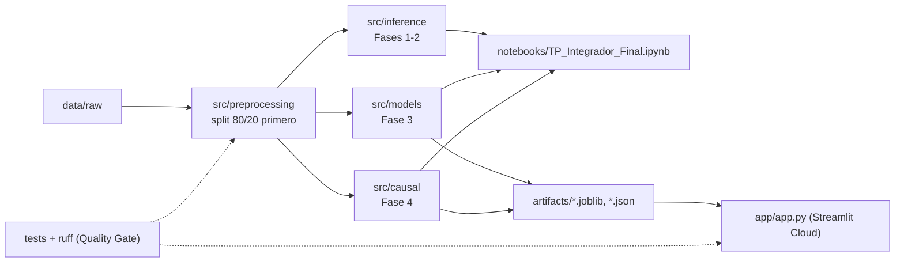

# 🧭 Decision Intelligence Capstone — Retorno Causal de un Motor de Recomendaciones

  -orange) 

**Cátedra:** Estadística Aplicada y Modelos de Regresión (EAyMR 2026) · UCA — Facultad de Ingeniería y Ciencias Agrarias · Prof. Iván G. Vilaboa
**Dominio:** E-Commerce, Plataformas y Growth Marketing
**Pregunta causal:** ¿Qué efecto causal tiene un incentivo personalizado / motor de recomendaciones (**T**) sobre la retención o el valor del cliente (**Y**), una vez aislado el sesgo de autoselección de los usuarios recurrentes (**Z**)?

> **Predicción vs. intervención:** $P(Y \mid X)$ responde *"¿quién se va a ir?"*; $P(Y \mid do(T=t))$ responde *"¿a quién le conviene darle el cupón?"*. Este proyecto separa ambas preguntas.

---

## 👥 Equipo y roles Scrum (3 integrantes)

| Rol | Integrante | Responsabilidad principal |
|---|---|---|
| 👑 Project Lead & Scrum Master (PO) | **Carola Nasif** | Slicing, issues/milestones, contratos de datos, Fase 1 y merge a `main` **solo con firma de QA** |
| ⚙️ Backend & ML / Causal Engineer | **Julián Agustín Lozano** | `src/`, statsmodels, scikit-learn, DoWhy, EconML (Fases 3 y 4), artefactos `joblib/json` |
| 🎨 Frontend & UI/UX + 🔍 QA & Validation Engineer | **Emilia Mortarini** | `app/` Streamlit, 3 módulos interactivos, deploy + `tests/`, `ruff`, veredicto **[APROBADO]/[BLOQUEADO]** por PR |

*(Nota: Al ser 3 integrantes según permite el enunciado de 3-4 miembros, se articulan los 4 roles Scrum formales).*

## 🗂️ Estructura

```
TPI_Decision_Intelligence_EAyMR/
├── app/app.py                     # Web App (Diagnóstico/PCA · What-Is · What-If)
├── artifacts/                     # modelos y resultados serializados que consume la app
├── data/                          # raw/ (no versionado) y processed/ — ver data/README.md
├── docs/                          # planificación y guía metodológica
│   ├── 01_propuestas_datasets_y_dags.md
│   ├── 02_guia_metodologica_paso_a_paso.md
│   └── 03_plan_accion_scrum_72hs.md
├── notebooks/TP_Integrador_Final.ipynb   # (a crear) notebook maestro
├── src/                           # lógica reutilizable (preprocessing, inference, models, causal)
├── tests/test_quality_gate.py     # Quality Gate determinístico
├── BITACORA.md                    # bitácora viva (5 entradas obligatorias)
├── pyproject.toml                 # config ruff + pytest
└── requirements.txt
```

## 🔁 Arquitectura del flujo



## ▶️ Reproducción

```bash
python3.11 -m venv .venv && source .venv/bin/activate
pip install -r requirements.txt
# descargar datos: ver data/README.md
ruff check . && pytest -q                         # Quality Gate
jupyter nbconvert --to notebook --execute notebooks/TP_Integrador_Final.ipynb   # Restart & Run All
streamlit run app/app.py
```

## 🌐 Deploy

URL pública: _pendiente (Streamlit Community Cloud)_

## 📅 Hitos

| Hito | Fecha |
|---|---|
| Elección de dataset | Jue 12/11/2026 21:00 |
| **Code freeze técnico** (repo, notebook, bitácora, deploy) | **Dom 15/11/2026 23:59** |
| Slides (10-12) + ensayos | Lun 16 – Mar 17/11 |
| **Defensa oral** (12-15 min) · entrega oficial en EVA 23:59 | **Mié 18/11/2026** |

## 📚 Fuentes y licencias

Se completan al elegir el dataset (ver `docs/01_propuestas_datasets_y_dags.md`). Uso de IA documentado en `BITACORA.md` → Entrada 5.
