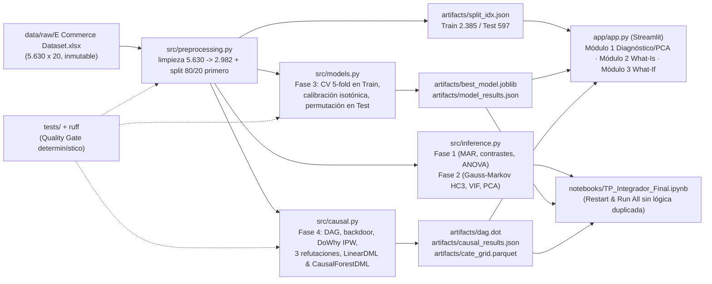

# 🧭 Decision Intelligence Capstone — Retorno Causal de un Motor de Recomendaciones


[](https://tpi-eamr-grupo-atomos.streamlit.app/)

**Cátedra:** Estadística Aplicada y Modelos de Regresión (EAyMR 2026) · Universidad Católica Argentina (UCA) · Facultad de Ingeniería y Ciencias Agrarias · **Profesor:** Iván G. Vilaboa  
**Dominio:** E-Commerce, Plataformas y Growth Marketing

---

## 🎯 Pregunta central: $\mathbb{P}(Y \mid X)$ vs. $\mathbb{P}(Y \mid \text{do}(T))$

Las plataformas de e-commerce suelen asignar cupones e incentivos observando correlaciones históricas donde usuarios más activos muestran menor tasa de abandono (*churn*). Sin embargo, **predecir riesgo no equivale a intervenir con éxito**:

* **Pregunta predictiva — $\mathbb{P}(Y \mid X)$ (*What-Is*):** *¿Qué clientes tienen alta probabilidad de churn en el próximo período, y qué tan bien calibradas están esas probabilidades?*
* **Pregunta causal — $\mathbb{P}(Y \mid \text{do}(T=t))$ (*What-If*):** *¿Cuál es el efecto causal promedio ($\text{ATE}$) y heterogéneo ($\text{CATE}$) de usar cupones ($T =$ `coupon_any`) sobre el churn ($Y$), una vez bloqueados los caminos de puerta trasera por los confusores pre-tratamiento $Z$?*

Este repositorio separa estrictamente ambos paradigmas de decisión —un torneo predictivo calibrado para **detectar riesgo** y una arquitectura causal estructural (*DoWhy + EconML*) para **evaluar si el incentivo funciona y es rentable**— demostrando empíricamente que la variable que mejor predice (`Tenure`) no coincide con la palanca comercial evaluada (`coupon_any`).

---

## 👥 Equipo y roles Scrum (3 integrantes · 4 roles formales)

| Rol Scrum | Integrante | Responsabilidad principal |
|---|---|---|
| 👑 **Project Lead & Scrum Master (PO)** | **Carola Nasif** (`@CarolaNasif`) | Slicing, milestones/issues, contrato de datos, Fase 1 (inferencia clásica/MAR/ANOVA), Bitácora Entradas 1 y 4 (§4.1–§4.3), conclusiones ejecutivas, esqueleto de slides y merges a `main` **solo con `[APROBADO]` de QA** |
| ⚙️ **Backend & ML / Causal Engineer** | **Julián Agustín Lozano** (`@lozano-julian`) | Preprocesamiento (`src/preprocessing.py`), auditoría forense de copias, Fase 3 (`src/models.py`), Fase 4 causal (`src/causal.py`, Bitácora §4.4), artefactos `joblib/json/parquet` y ensayo crítico |
| 🎨 **Frontend & UI/UX + 🔍 QA & Validation Engineer** | **Emilia Mortarini** (`@EmiMortarini`) | Fase 2 (`src/inference.py`: MCO/HC3, Cook/Huber, VIF y PCA *train-only*), Web App en Streamlit (`app/app.py`, 3 módulos interactivos), deploy en Streamlit Cloud, Bitácora Entradas 2–3 y veredicto `[APROBADO]/[BLOQUEADO]` por PR |

*(Por tratarse de un equipo de 3 integrantes según admite el enunciado de 3–4 miembros, se articulan formalmente los 4 roles Scrum mediante co-auditoría cruzada).*

---

## 📦 Dataset, fuente, licencia y auditoría de limpieza

* **Dataset elegido (Opción A):** [*Ecommerce Customer Churn Analysis and Prediction*](https://www.kaggle.com/datasets/ankitverma2010/ecommerce-customer-churn-analysis-and-prediction) (Kaggle, autor: Ankit Verma).
* **Archivo crudo:** `data/raw/E Commerce Dataset.xlsx` (hoja `E Comm`, `5.630` filas $\times$ `20` columnas).
* **Licencia verificada en Kaggle:** [**CC BY-NC-SA 4.0**](https://creativecommons.org/licenses/by-nc-sa/4.0/) (*Creative Commons Attribution-NonCommercial-ShareAlike 4.0 International* — uso académico y no comercial con atribución).
* **Uso en deploy (Módulo 1 · `Diagnóstico & PCA`):** bajo esta licencia **CC BY-NC-SA 4.0** se autoriza versionar en el repositorio el archivo limpio `data/processed/dataset_clean.parquet` (`N = 2.982`) o una muestra equivalente citando explícitamente la fuente (Ankit Verma / Kaggle) y la licencia en este `README.md` y en `app/app.py`.
* **Huella de integridad (SHA-256 del archivo crudo):**
  ```text
  db70f1e34bc5326887ea3fb3d2a0854e82c577d55ef3a76fdfb25328631bd44d
  ```

### Limpieza forense y contrato de variables ($5.630 \to 2.982$)

Durante la Fase 3 (`BITACORA.md`, Entrada 3 — Experimento fallido #1) se detectó que la tabla cruda provenía de un aumento sintético con ruido: **`2.638` clientes con `CustomerID` desplazado en `+1470`** repetían al cliente de `ID` base en `14–19` de las `19` columnas con exactamente el **mismo `Churn` en el 100% de los pares** (y `CouponUsed` era la variable más perturbada, en `1.469` pares). Conservar esas copias generaba *fold-leakage* (inflando artificialmente el ROC-AUC de `0,948` a `0,993`) y atenuaba el efecto causal de $T$.

La función `near_duplicate_copies()` de [`src/preprocessing.py`](src/preprocessing.py) depura los duplicados **antes** del split estratificado `80/20`:

| Métrica de auditoría | Antes (crudo) | Después (limpio) | Nota metodológica |
|---|---:|---:|---|
| Filas independientes | `5.630` | **`2.982`** | Eliminadas `2.638` copias casi duplicadas (`ID + 1470`) + `10` duplicados exactos restantes |
| Partición persistida (`RANDOM_STATE = 42`) | — | **`Train 2.385` / `Test 597`** | Guardada en [`artifacts/split_idx.json`](artifacts/split_idx.json); `Test` reservado intacto |
| Tasa global de `Churn` ($Y$) | `16,84%` | **`17,30%`** | `516` churners / `2.466` retenidos (`Train: 17,32%`, `Test: 17,25%`) |
| Tratamiento observado (`coupon_any = CouponUsed >= 1`) | — | **`80,73%` tratados** | `2.300` tratados (`T=1`), `549` controles (`T=0`), `133` NA sin imputar (`MAR`) |
| Categorías normalizadas | `3 / 7 / 6` | **`2 / 5 / 5`** | Unificadas variantes equivalentes en Login (`Mobile Phone`), Payment (`CC`/`COD`) y OrderCat (`Mobile`) |

* **Contrato estructural del DAG (Opción A):**
  * **$Y$ (Outcome):** `Churn` $\in \{0, 1\}$.
  * **$T$ (Tratamiento):** `coupon_any` $= \mathbb{I}(\text{CouponUsed} \ge 1)$ (entero nullable; no imputado).
  * **$Z$ (Set de ajuste *backdoor*, 13 confusores pre-tratamiento):** `Tenure`, `Complain`, `SatisfactionScore`, `CityTier`, `PreferedOrderCat`, `HourSpendOnApp`, `PreferredLoginDevice`, `PreferredPaymentMode`, `Gender`, `MaritalStatus`, `WarehouseToHome`, `NumberOfAddress`, `NumberOfDeviceRegistered`.
  * **$M$ (Mediadores post-tratamiento, excluidos de $Z$):** `OrderCount`, `CashbackAmount` ($T \to M \to Y$).
  * **$C$ (Colisionador, excluido de $Z$):** `DaySinceLastOrder` ($T \to C \leftarrow Y$).
  * **Latente no observada ($U$):** `U_engagement` $\to \{\text{HourSpendOnApp}, T, Y\}$.

---

## 🔁 Arquitectura del flujo (`src → artifacts → app`)



---

## ▶️ Reproducción paso a paso

> **Prerrequisito:** Python **3.11** (recomendado por compatibilidad verificada con `dowhy` 0.12 y 0.14 —la versión fijada en `requirements.lock`—, `econml`, `pandas<3` y `networkx<3.5`).

1. **Clonar el repositorio y crear el entorno virtual en Python 3.11:**
   ```bash
   git clone https://github.com/CarolaNasif/TPI_Decision_Intelligence_EAyMR.git
   cd TPI_Decision_Intelligence_EAyMR

   # Linux / macOS:
   python3.11 -m venv .venv && source .venv/bin/activate
   # Windows PowerShell:
   # py -3.11 -m venv .venv; .\.venv\Scripts\Activate.ps1

   pip install -r requirements.txt
   # O para reproducir exactamente los 163 paquetes congelados en el entorno de validación:
   # pip install -r requirements.lock
   ```

2. **Descargar el dataset crudo de Kaggle a `data/raw/E Commerce Dataset.xlsx`:**
   ```bash
   kaggle datasets download -d ankitverma2010/ecommerce-customer-churn-analysis-and-prediction -p data/raw --unzip
   ```
   *(Verificar que la hoja `E Comm` exista y el SHA-256 coincida con `db70f1e34bc5326887ea3fb3d2a0854e82c577d55ef3a76fdfb25328631bd44d`; ver detalles en [`data/README.md`](data/README.md)).*

3. **Ejecutar el pipeline reproducible desde `src/` (genera dataset procesado, modelos y artefactos causales):**
   ```bash
   python -m src.preprocessing
   python -m src.models
   python -m src.causal
   ```

4. **Validar el Quality Gate (linter + tests unitarios, anti-leakage e integración):**
   ```bash
   ruff check .
   pytest -q
   ```

5. **Ejecutar el notebook maestro de punta a punta (*Restart & Run All*):**
   ```bash
   jupyter nbconvert --to notebook --execute --inplace notebooks/TP_Integrador_Final.ipynb
   ```

6. **Lanzar la aplicación web interactiva en Streamlit:**
   ```bash
   streamlit run app/app.py
   ```

---

## 📊 Resultados clave y recomendación de política

### 1. Fase 1 — Inferencia clásica, faltantes y ANOVA (`N = 2.982`)

| Análisis / Contraste | Hallazgo estadístico verificado | Decisión e implicancia para el DAG |
|---|---|---|
| **Mecanismo de NA** (`7` cols, `4,39%–5,43%`) | Test de Little EM $d^2 = 2.875{,}89$ ($\text{gl}=77$, $p < 10^{-300}$); regresión logística MAR `AUC = 0,898–0,996` (`coupon_any`: `AUC = 0,965`) | Se rechaza MCAR; evidencia fuerte de MAR. Imputación + indicador binario **dentro del `Pipeline` en Train**; `133` NA en $T$ sin imputar |
| **Contraste 1 (`CashbackAmount` por `Churn`)** | Diferencia `−$19,36` (IC 95% `[−23,27; −15,44]`), Welch $t = -9{,}71$ ($p = 2{,}85 \times 10^{-21}$), Mann-Whitney $p = 4{,}34 \times 10^{-20}$, Cohen's $d = -0{,}3955$, potencia `1,0000` | Se rechaza $H_0$; aunque el cashback medio difiere por churn, `CashbackAmount` es **mediador ($M$)** y queda fuera de $Z$ |
| **Contraste 2 (`Complain` vs `Churn`)** | `32,63%` churn con reclamo vs. `11,11%` sin reclamo (`+21,52 pp`), $\chi^2 = 197{,}84$ ($p = 6{,}19 \times 10^{-45}$), $V$ de Cramér $= 0{,}2576$, $\text{OR} = 3{,}88$ | Se rechaza $H_0$; `Complain` es un confusor crítico pre-tratamiento |
| **ANOVA (`CashbackAmount ~ PreferedOrderCat`)** | Levene $F = 19{,}28$ ($p = 1{,}14 \times 10^{-15}$); Welch $F = 5.258{,}31$ ($\eta^2 = 0{,}8269$); Kruskal $H = 2.138{,}35$ ($p < 10^{-300}$); `10/10` pares significativos en Games-Howell | Se rechaza $H_0$; el rubro explica el `82,7%` de la varianza de `CashbackAmount` (confusión estructural confirmada) |

### 2. Fase 3 — Torneo predictivo ($\mathbb{P}(Y \mid X)$, `Train = 2.385` / `Test = 597`)

| Modelo (evaluación única en Test) | CV ROC-AUC (Train) | Test ROC-AUC (IC 95%) | Test PR-AUC | Test Brier | Test ECE |
|---|---:|---:|---:|---:|---:|
| **Random Forest + calibración isotónica** | — *(5-fold en Train)* | **0,9461** `[0,9218; 0,9676]` | 0,8062 | **0,0643** | **0,0179** |
| Random Forest base *(OOB AUC = `0,9411`)* | `0,9320 ± 0,0147` | `0,9434` `[0,9163; 0,9677]` | **0,8194** | `0,0716` | `0,0790` |
| Logística ElasticNet ($\alpha = 0, C = 100$) | `0,8935 ± 0,0061` | `0,8870` `[0,8519; 0,9207]` | `0,6817` | `0,0895` | `0,0225` |
| CART podado (`ccp_alpha = 0,0019`) | `0,8477 ± 0,0222` | `0,8355` `[0,7933; 0,8792]` | `0,5079` | `0,1070` | `0,0485` |
| CART sin podar *(`Train AUC = 1,0000`)* | — | `0,8066` `[0,7602; 0,8488]` | `0,4705` | `0,1357` | `0,0385` |
| Naive Bayes *(Gaussiano)* | `0,7857 ± 0,0194` | `0,7544` `[0,6985; 0,8051]` | `0,4427` | `0,3223` | `0,3650` |

* **Top-4 por importancia por permutación sobre Test ($\Delta\text{ROC-AUC}$):** `Tenure` (`0,2024`, `#1`), `Complain` (`0,0365`, `#2`), `PreferedOrderCat` (`0,0251`, `#3`) y `DaySinceLastOrder` (`0,0170`, `#4`).
* **Sesgo MDI vs. Permutación:** `CashbackAmount` figura `#2` en MDI (`0,0857`), pero cae al **puesto `#18` (`-0,0010`)** por permutación en Test; `CouponUsed` queda `#16` (`+0,0003`).

### 3. Fase 4 — Inferencia causal y Causal ML ($\mathbb{P}(Y \mid \text{do}(T))$, soporte común `N = 2.012`)

* **Positividad y balance:** se excluyeron **`808` clientes** en estratos con `100%` de uso de cupones (p. ej., `HourSpendOnApp = 4` con `605` clientes, `WarehouseToHome = 7` con `202`, `NumberOfDeviceRegistered = 6` con `87`) y `29` casos fuera del *propensity* $[0{,}05;\, 0{,}95]$. Tras IPW en soporte común (`N = 2.012`: `1.463` tratados / `549` controles), $|\text{SMD}|_{\max}$ baja de `0,483` a `0,107`.

| Estimador / Prueba causal | Población | ATE sobre Churn (pp) | IC 95% / $p$-valor | Interpretación |
|---|---:|---:|---:|---|
| **Backdoor: regresión lineal (principal)** | `2.012` | **`−1,16 pp`** | **`[−4,60; +2,28]` pp** | **No se rechaza $H_0: \text{ATE} = 0$** |
| **Backdoor: IPW** (*trimming* `[0,05; 0,95]`) | `2.012` | **`−1,09 pp`** | `[−5,56; +3,14]` pp | No se rechaza $H_0$ |
| **LinearDML (EconML)** | `2.012` | **`+1,11 pp`** | `[−2,03; +4,24]` pp | No se rechaza $H_0$ (signo positivo) |
| **CausalForestDML (EconML)** | `2.012` | **`+1,42 pp`** | `[−1,46; +4,29]` pp | No se rechaza $H_0$ (signo positivo) |
| Dosis-respuesta por cupón adicional (`CouponUsed`) | `2.012` | **`+1,07 pp / cupón`** | `[+0,14; +2,00]` pp ($p = 0{,}024$) | Mayor intensidad se asocia a mayor churn |
| **CATE por segmentos** (`Complain = 1`, DML coef.) | `2.012` | `+7,1 pp` | `[−0,5; +14,6]` pp ($p = 0{,}065$) | Ningún subgrupo significativo |
| **Refutaciones DoWhy (3/3 verdes 🟢)** | `2.012` | `−1,16` / `+0,09` / `−0,99` pp | $p = 0{,}90$ / `0,96` / `0,88` | Random Common Cause, Placebo, Data Subset `80%` |
| Sensibilidad a confusor no observado | `2.012` | `[−1,75; +6,17]` pp | `strengths = 0,01–0,10` | Un confusor latente moderado invierte o anula el ATE |

### 4. Regla de decisión económica y recomendación

Con costo unitario del cupón $c$ y valor esperado de retener al cliente $V$, otorgar el cupón es rentable solo si **`−ATE · V > c`**. Como todos los IC 95% incluyen `0`, no hay evidencia causal de que el cupón retenga; **aun en la cota más optimista del IC (`−4,60 pp`) se requiere `c < 0,046 · V`** (y en la estimación puntual, `c < 0,0116 · V`).  
**Política recomendada:** usar `Random Forest + isotónica` **solo para detectar riesgo ($\mathbb{P}(Y \mid X)$)**, reasignar presupuesto de cupones inframarginales hacia *onboarding* temprano (`Tenure`), resolver operativamente la causa raíz de reclamos (`Complain`) y validar cualquier incentivo futuro con un **experimento A/B aleatorio (`RCT`)**.

---

## 🗂️ Estructura del repositorio

```text
TPI_Decision_Intelligence_EAyMR/
├── app/
│   └── app.py                          # Web App Streamlit (Diagnóstico/PCA · What-Is · What-If)
├── artifacts/
│   ├── split_idx.json                  # Índices fijos Train (2.385) / Test (597)
│   ├── best_model.joblib               # Random Forest calibrado (isotónica) — Fase 3 (PR #12)
│   ├── model_results.json              # Métricas CV/Test e importancia permutación vs MDI (PR #12)
│   ├── dag.dot                         # Grafo causal DOT para renderizado Graphviz (PR #13)
│   ├── causal_results.json             # Estimadores ATE/CATE, overlap, balance y refutaciones (PR #13)
│   └── cate_grid.parquet               # Grilla de perfiles CATE (320 combinaciones, PR #13)
├── data/
│   ├── README.md                       # Descarga, licencia y checklist de integridad
│   ├── raw/                            # E Commerce Dataset.xlsx (inmutable, no versionado)
│   └── processed/                      # dataset_clean.parquet (sin imputar; generado por preprocessing)
├── docs/
│   ├── 01_propuestas_datasets_y_dags.md
│   ├── 02_guia_metodologica_paso_a_paso.md
│   ├── 03_plan_accion_scrum_72hs.md
│   ├── 04_esqueleto_slides.md          # Guion estructural de la defensa oral (12 slides)
│   └── 04_esqueleto_slides.pdf         # Esqueleto preliminar en PDF (12 páginas)
├── notebooks/
│   └── TP_Integrador_Final.ipynb       # Notebook maestro (Secciones 0, 1, 3, 4, 5, 6, 7 y 8; Fase 2 pendiente)
├── src/
│   ├── __init__.py                     # Semilla única RANDOM_STATE = 42 y rutas del proyecto
│   ├── preprocessing.py                # Carga, limpieza (ID+1470), split 80/20, missingness_report
│   ├── inference.py                    # Fase 1 (contrastes, potencia, ANOVA) y Fase 2 (Gauss-Markov/PCA)
│   ├── models.py                       # Fase 3: torneo 4 familias, calibración y permutación (PR #12)
│   └── causal.py                       # Fase 4: DAG, backdoor, DoWhy, overlap, refutaciones y DML (PR #13)
├── tests/
│   ├── conftest.py
│   ├── test_causal.py                  # Validación causal con efecto verdadero conocido (-0,10) (PR #13)
│   ├── test_causal_stack.py            # Smoke test reproducible DoWhy + EconML
│   ├── test_inference.py               # Pruebas Fase 1 sobre datos sintéticos y make_clean_dataset()
│   ├── test_models.py                  # Validación anti-leakage y calibración Fase 3 (PR #12)
│   ├── test_preprocessing.py           # Pruebas de duplicados, near-duplicates, categorías y split
│   └── test_quality_gate.py            # Quality Gate determinístico de integración
├── BITACORA.md                         # Bitácora viva de ingeniería (Entradas 1 a 5 obligatorias)
├── pyproject.toml                      # Configuración de ruff + pytest
├── README.md                           # Este documento
└── requirements.txt                    # Dependencias fijadas (incluye pandas<3 y networkx<3.5)
```

---

## 🔗 Enlaces clave y despliegue

* **Bitácora de ingeniería (5 entradas + trazabilidad IA):** [`BITACORA.md`](BITACORA.md)
* **Notebook maestro:** [`notebooks/TP_Integrador_Final.ipynb`](notebooks/TP_Integrador_Final.ipynb)
* **Esqueleto de presentación (defensa oral):** [`docs/04_esqueleto_slides.md`](docs/04_esqueleto_slides.md) · [`docs/04_esqueleto_slides.pdf`](docs/04_esqueleto_slides.pdf)
* **Web App desplegada (Streamlit Community Cloud):** [https://tpi-eamr-grupo-atomos.streamlit.app/](https://tpi-eamr-grupo-atomos.streamlit.app/)

---

## 📅 Hitos del proyecto

| Hito | Fecha | Estado |
|---|---|---|
| Selección unánime Dataset A + hash SHA-256 | Sáb 14/11/2026 15:00 | ✅ Cerrado (Entrada 1) |
| **Code freeze técnico** (repo, notebook maestro, bitácora, deploy) | **Dom 15/11/2026 23:59** | 🟡 En progreso |
| Slides finales (10–12 PDF con figuras) + ensayos cronometrados | Lun 16 – Mar 17/11/2026 | 🟡 Esqueleto listo |
| **Defensa oral** (12–15 min) · entrega oficial en EVA 23:59 | **Mié 18/11/2026** | ⏳ Programada |

---

> *El uso de asistentes de IA como apoyo metodológico y de ingeniería, junto con sus verificaciones determinísticas y correcciones de alucinaciones, se encuentra auditado íntegramente en [`BITACORA.md`](BITACORA.md) → Entrada 5.*
