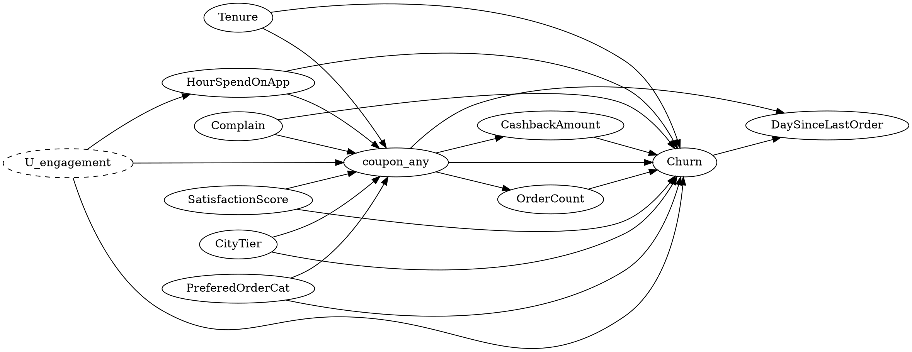
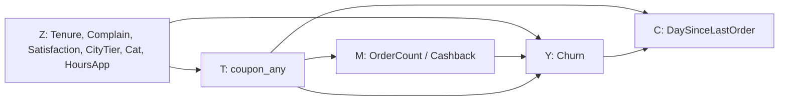
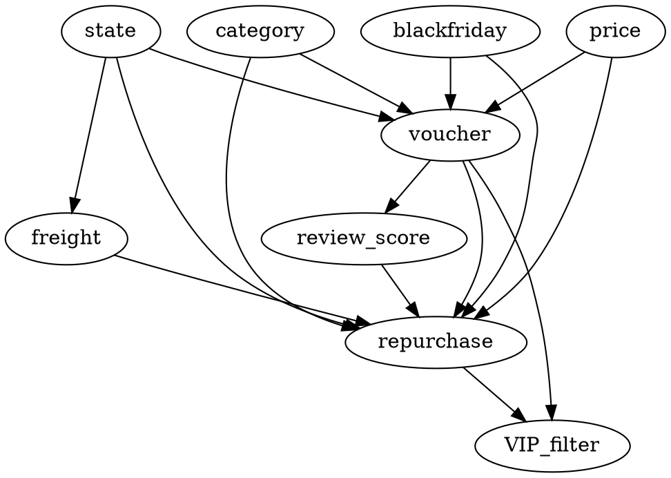

# 01 · Propuestas de Datasets y DAGs Causales

> **Pregunta del dominio (enunciado):** ¿Qué incremento causal en retención / CLV ($Y$) genera la asignación de un motor de recomendaciones o cupón ($T$), distinguiendo la autoselección de usuarios recurrentes ($Z$) del efecto genuino de la política?
>
> **Decisión:** jueves 12/11, 21:00 hs. Criterio de desempate en §4.

---

## 0. Criterios de evaluación de cada candidato

| Criterio | Por qué importa en la rúbrica |
|---|---|
| N ≥ 1.500, ≥ 10 explicativas mixtas | Requisito excluyente |
| Fricción real: NA, asimetría, colas, colinealidad | Fase 1 (MCAR/MAR/MNAR), Fase 2 (Cook, VIF, PCA), rúbrica 1.3 "Auditoría forense" |
| $T$, $Y$, $Z$, $M$, $C$ **observables** con sentido de negocio | Fase 4 (25 pts), la más pesada |
| Target binario y continuo disponibles | Fase 3 clasificación (OR, Brier, calibración) + Fase 2 MCO |
| Costo de ingeniería en 72 hs | Riesgo de no llegar al deploy (15 pts) |
| Potencial de "choque" predictivo vs causal | Ensayo crítico de Fase 4 |

---

## OPCIÓN A ⭐ — *E-Commerce Customer Churn* (Kaggle)

**Fuente:** kaggle.com/datasets/ankitverma2010/ecommerce-customer-churn-analysis-and-prediction · **N = 5.630 clientes · 20 columnas** (18 explicativas + ID + target). Archivo `.xlsx` con diccionario de datos.

### Variables (diccionario)

| Variable | Tipo | Rol causal propuesto |
|---|---|---|
| `Churn` | binaria (≈17% positivos) | **Y** (retención = 1 − Churn) |
| `CouponUsed` | discreta (conteo último mes, **con NA**) | **T** → binarizada `coupon_any = 1{CouponUsed ≥ 1}` (alternativa: T continua) |
| `Tenure` | discreta (**con NA**) | **Z** clave — *proxy* de usuario recurrente (autoselección) |
| `Complain` | binaria | **Z** — reclamos disparan cupones compensatorios **y** churn |
| `SatisfactionScore` | ordinal 1-5 | **Z** (pre-tratamiento, supuesto a discutir) |
| `CityTier`, `PreferredLoginDevice`, `PreferredPaymentMode`, `Gender`, `MaritalStatus`, `PreferedOrderCat` | categóricas | **Z** (segmentación del CRM / modificadores de efecto para CATE) |
| `WarehouseToHome` (**NA**), `NumberOfDeviceRegistered`, `NumberOfAddress`, `HourSpendOnApp` (**NA**), `OrderAmountHikeFromlastYear` (**NA**) | continuas/discretas | **Z** |
| `OrderCount` (**NA**) | discreta | **M** — el cupón induce más pedidos, que a su vez retienen |
| `CashbackAmount` | continua, asimétrica | **M₂** (beneficio monetario derivado del incentivo) · **Y continua** para MCO de Fase 2 |
| `DaySinceLastOrder` (**NA**) | discreta | **C** — colisionador/descendiente: el cupón reduce los días desde la última compra (T → C) y el churn los aumenta (Y → C) |

### Fricciones reales esperadas
- **7 columnas con ≈4-6% de NA** (`Tenure`, `WarehouseToHome`, `HourSpendOnApp`, `OrderAmountHikeFromlastYear`, `CouponUsed`, `OrderCount`, `DaySinceLastOrder`) → ideal para testear MCAR (Little) vs MAR (logit del indicador de NA) vs MNAR (p.ej. `Tenure` faltante en clientes nuevos).
- Categorías inconsistentes (`Phone` vs `Mobile Phone`, `CC` vs `Credit Card`, `COD` vs `Cash on Delivery`) → limpieza documentada.
- Colas pesadas en `CashbackAmount`, `WarehouseToHome` (outliers > 100), `Tenure`.
- Colinealidad esperada `CouponUsed`–`OrderCount`–`CashbackAmount`.

### DAG propuesto

**Set de ajuste backdoor:** $Z = \{$Tenure, Complain, SatisfactionScore, CityTier, PreferedOrderCat, HourSpendOnApp, Device, Payment, Gender, MaritalStatus, WarehouseToHome, NumberOfAddress, NumberOfDeviceRegistered$\}$. **Excluidos:** `OrderCount`, `CashbackAmount` (M), `DaySinceLastOrder` (C).

### Por qué es ideal para el Choque Causal vs Predictivo
- `DaySinceLastOrder` y `Tenure` serán casi seguro top-features del Random Forest. Pero `DaySinceLastOrder` es **consecuencia** del churn (colisionador/descendiente de Y): es un gran predictor y **una palanca inútil** ("bajar los días desde la última compra" no es una acción, es un síntoma).
- `Complain` → cupón compensatorio → los usuarios con cupón tienen *más* churn en bruto: el **coeficiente ingenuo puede tener signo opuesto** al efecto causal ajustado (paradoja tipo Simpson demostrable).
- Condicionar sobre `OrderCount` (M) subestima el efecto total del cupón → trampa del mediador cuantificable.

### Riesgos / mitigación
| Riesgo | Mitigación |
|---|---|
| Procedencia poco documentada (empresa anónima; posible anonimización/semisíntesis) | Declararlo en Bitácora Entrada 1 y 4 como amenaza a validez externa; hash SHA-256 del archivo |
| Corte transversal: "último mes" para T, M, C y Churn → orden temporal asumido | Justificar cada arco en Entrada 4; análisis de sensibilidad excluyendo `SatisfactionScore` |
| T = "usó cupón" (no "recibió cupón") → efecto tipo TOT, no ITT | Discutirlo explícitamente en el ensayo crítico |
| Dataset popular en Kaggle | El valor diferencial está en Fase 4 (casi nadie lo usa causalmente) |

**Costo de ingeniería:** 🟢 bajo (tabla única) · **Encaje con rúbrica:** 🟢 alto en las 5 fases.

---

## OPCIÓN B — *Olist Brazilian E-Commerce* (Kaggle)

**Fuente:** kaggle.com/datasets/olistbr/brazilian-ecommerce · **~99.441 pedidos, ~96k clientes únicos, 9 tablas relacionales** (2016-2018). Datos reales anonimizados de un marketplace.

**Unidad de análisis:** cliente (`customer_unique_id`) en su **primer pedido** (cohorte de adquisición).

| Rol | Variable (construida) |
|---|---|
| **T** | `voucher_first_order = 1` si el primer pedido usó `payment_type == 'voucher'` (≈5% de los pagos) |
| **Y** | `repurchase_180d` (binaria; recompra ≈3% → fuerte desbalance) · **Y continua:** gasto posterior acumulado (proxy CLV) |
| **Z** | precio y flete del primer pedido, ratio flete/precio, categoría del producto, estado del cliente, cuotas (`payment_installments`), mes de compra (Black Friday 2017), fotos/peso/largo de descripción del producto, distancia cliente-vendedor (geolocalización) |
| **M** | `review_score` del primer pedido (cupón → valor percibido → satisfacción → recompra) y `n_items` del carrito |
| **C** | selección "clientes con review escrita" o "clientes VIP por gasto" (variable afectada por T y por Y → sesgo de Berkson por filtrado) |

**Fricciones:** NA reales MNAR (`review_comment_message` ≈ 58% vacío — escriben los muy satisfechos o muy enojados), fechas de entrega faltantes en pedidos cancelados, dimensiones de producto faltantes, precios con colas muy pesadas, colinealidad peso-volumen-flete.

**Por qué sirve para el choque:** el tiempo de entrega y `review_score` predicen muy bien la recompra, pero el `review_score` es mediador (no palanca directa) y el *filtro de clientes con review* induce sesgo de selección.

**Riesgos:** 🔴 ingeniería alta (joins de 6+ tablas, ventanas temporales, censura a la derecha en clientes recientes); Y extremadamente desbalanceada (3%) complica Brier/calibración y CATE; el vínculo "voucher ↔ motor de recomendaciones" es indirecto.

**Costo:** 🔴 alto · **Encaje con rúbrica:** 🟢 autenticidad máxima, 🟡 en tiempos.

---

## OPCIÓN C — *Lenta Uplift* (BigTarget Hackathon, retail ruso, vía `scikit-uplift`)

**Fuente:** `sklift.datasets.fetch_lenta()` · **687.029 clientes × 193 features** + `group` (SMS de campaña personalizada: test/control, **aleatorizado**) + `response_att` (visita/compra en la ventana de campaña). Se trabaja con una submuestra estratificada (p.ej. 30k).

| Rol | Variable |
|---|---|
| **T** | `group` (test = recibió comunicación personalizada) |
| **Y** | `response_att` (binaria) |
| **Z** | `age`, `gender` (**NA**), `main_format`, `children`, antigüedad de registro, historial de respuesta a SMS/Viber (*autoselección de usuarios receptivos*), conteo de tickets y montos de venta (12m/6m/3m/1m/15d), profundidad de descuento, `promo_share`, `food_share` |
| **M** | **No observado** (apertura del SMS / visita a la tienda) → nodo latente en el DAG |
| **C** | **No observado** naturalmente → se ilustra con simulación controlada |

**Diseño propuesto (semi-observacional):** como el experimento es aleatorizado, el ATE del RCT completo es la **verdad de referencia**. Se construye una muestra "observacional" sesgando la asignación (retener tratados con probabilidad creciente en `response_sms` y gasto histórico, imitando un CRM que apunta a los recurrentes). Luego se muestra que la regresión ingenua se aleja de la verdad y que backdoor/IPW/DML la **recuperan** → validación empírica de la identificación.

**Fricciones:** cientos de NA (columnas con > 30% faltante), colinealidad extrema (mismas métricas en 5 ventanas temporales → VIF enormes, PCA brillante), montos con colas muy pesadas, edades imposibles.

**Por qué sirve para el choque:** el gasto histórico predice la respuesta mejor que el SMS, pero el SMS es la única palanca; los "sure things" (siempre compran) aparecen como alta probabilidad predictiva pero CATE ≈ 0.

**Riesgos:** 🟡 nombres de features crípticos (requiere diccionario), descarga pesada, M y C no observables (debilita el criterio "identifica M y C" de la Fase 4), el sesgo de confusión es "inducido" por el equipo y hay que justificarlo muy bien.

**Costo:** 🟡 medio · **Encaje con rúbrica:** 🟢 refutaciones y benchmark, 🟡 en M/C.

---

## 4. Matriz de decisión (puntaje 1-5)

| Criterio (peso) | A · Churn | B · Olist | C · Lenta |
|---|---|---|---|
| Fricción real para Fases 1-2 (20%) | 4 | 5 | 5 |
| T/Y/Z/M/C observables (30%) | **5** | 4 | 2 |
| Viabilidad en 72 hs (25%) | **5** | 2 | 3 |
| Potencial de choque causal vs predictivo (15%) | 5 | 4 | 4 |
| Autenticidad / procedencia (10%) | 2 | **5** | 5 |
| **Total ponderado** | **4,50** | 3,80 | 3,45 |

> [!IMPORTANT]
> **Recomendación:** arrancar con la **Opción A**. Si el equipo quiere un plus de excelencia en "Escenarios alternativos y sensibilidad" (rúbrica complementaria 3.1), usar **Hillstrom MineThatData (RCT, 64k)** o una submuestra de **Lenta** como *benchmark experimental* en un apéndice, sólo si el freeze del sábado 23:59 se cumplió.

### Descartados (y por qué)
- **Hillstrom Email (MineThatData):** RCT excelente con mediador (`visit`), pero solo 8 explicativas y sin faltantes → no cumple ≥10 ni la fricción exigida como dataset principal.
- **Criteo Uplift:** 12 features anónimas `f0..f11`, todas numéricas → no hay categóricas ni interpretación de negocio.
- **Open Bandit Dataset (ZOZOTOWN):** literalmente compara políticas de recomendación (Random vs Thompson Sampling), pero clicks ≈0,4% y features hasheadas → inviable en 72 hs.
- **Starbucks Rewards (Udacity):** datos **simulados** → riesgo de ser considerado *toy*.
