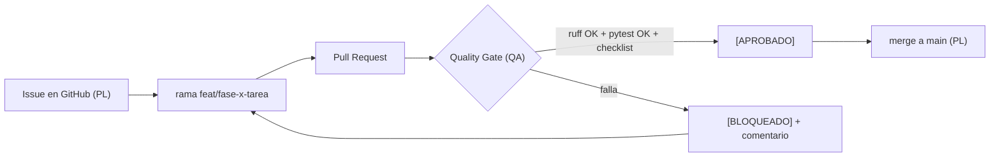

# 03 · Plan de Acción Scrum — Sprint Exprés de 72 hs

> **Sprint Goal:** el domingo **15/11/2026 23:59** hay en `main` un repo reproducible con notebook maestro ejecutado de punta a punta, `BITACORA.md` con 5 entradas firmadas y la web app **desplegada** con sus 3 módulos.
> **Entrega oficial en EVA y defensa:** miércoles 18/11/2026 (el freeze del domingo nos deja 3 días de colchón para slides y ensayo).

## Roles (Equipo de 3 integrantes cubriendo los 4 roles Scrum)

| Sigla | Rol | Integrante propuesto |
|---|---|---|
| **PL** | Project Lead & Scrum Master (PO) | **Carola Nasif** |
| **ML** | Backend & ML / Causal Engineer | **Julián Agustín Lozano** |
| **FE** | Frontend & UI/UX Engineer | **Emilia Mortarini** |
| **QA** | QA & Validation Engineer | **Emilia Mortarini** (con co-revisión de Carola Nasif en Fase 2) |

> [!TIP]
> Con 4 personas y 72 hs, **ML no puede hacer solo las 4 fases**. Regla de paralelización: ML es dueño de Fase 3 y 4; **PL** ejecuta Fase 1; **QA** ejecuta Fase 2 (diagnósticos = su especialidad); **FE** construye la app contra *artefactos mock* desde el día 1. Todos codean en `src/`, todos revisan cruzado.

---

## Flujo de trabajo Git y Quality Gate



### Definición del Quality Gate (determinístico)
Un PR recibe **[APROBADO]** solo si se cumplen **todas**:
1. `ruff check .` → 0 errores.
2. `pytest -q` → 100% verde (los `skip` deben estar justificados).
3. Ningún `fit` sobre datos de Test (revisión de diff: `grep -n "fit(" ` en archivos tocados).
4. Ninguna variable de `MEDIATORS` o `COLLIDERS` en el set de ajuste causal.
5. Semilla `RANDOM_STATE` usada en todo componente estocástico.
6. Notebook: las celdas nuevas tienen Markdown teórico previo y gráficos con título/ejes.
7. Si se usó IA en el PR → línea agregada en `BITACORA.md` Entrada 5.

Plantilla de comentario de QA en el PR:
```
QA VERDICT: [APROBADO] / [BLOQUEADO]
- ruff: OK | pytest: 18 passed, 4 skipped
- leakage check: OK
- causal contract: OK
- observaciones: ...
Firma: <nombre QA> · <fecha hora>
```

### Definition of Done (por historia)
Código en `src/` + llamada desde el notebook + test (si aplica) + entrada en Bitácora (si hubo decisión) + PR aprobado por QA.

---

## Cronograma de guerra

### 🟥 JUEVES 12/11 — Sprint 0: arranque (17:30 – 24:00)

| Hora | PL | ML | FE | QA |
|---|---|---|---|---|
| 17:30-19:00 | Leer `docs/01`; crear repo GitHub, proyecto (Kanban), milestones D1-D4, issues por fase | Leer `docs/01` y `docs/02` Fase 4; evaluar viabilidad causal de cada dataset | Crear cuenta Streamlit Cloud; "hello world" deployado desde el repo (**el deploy se valida el día 1, no el domingo**) | Crear `.venv` Python 3.11, `pip install -r requirements.txt`, correr `pytest` y `ruff`; resolver conflictos dowhy/econml |
| 19:00-20:30 | Descargar los 3 datasets (ver `data/README.md`); EDA "rápido" de 20 min c/u con el equipo | Prototipo express: ¿`CouponUsed`/`voucher`/`group` tienen variación y overlap razonables? | Wireframe de los 3 módulos (papel/Figma) | `requirements.lock` congelado; CI opcional (GitHub Actions con ruff+pytest) |
| **21:00** | 🗳️ **Daily + DECISIÓN DE DATASET** (matriz de `docs/01` §4) | ← | ← | ← |
| 21:00-24:00 | Completar contrato de datos en `src/preprocessing.py` (T, Y, Z, M, C); redactar Bitácora Entrada 1 | `load_raw_data`, limpieza de categorías, `split_train_test` + `split_idx.json` | Layout Streamlit con pestañas y **artefactos mock** (json/joblib falsos con el mismo esquema) | Tests de dimensiones y de contrato causal activados sobre el dataset elegido |

**Salida jueves:** dataset elegido, split persistido, app "hello world" pública, entorno congelado.

### 🟧 VIERNES 13/11 — Sprint 1: Fases 1 y 2 + base de Fase 3 (09:00 – 24:00)

| Bloque | PL | ML | FE | QA |
|---|---|---|---|---|
| 09:00 | Daily (15 min) | | | |
| 09:15-13:00 | **Fase 1:** auditoría forense, mecanismo de NA (Little + logit), 2 contrastes con IC y d | `build_preprocessor` (Pipeline/ColumnTransformer), `make_cv`; Familia 1 Logística + OR | Módulo 1 (Diagnóstico): filtros, histogramas, mapa de NA con datos reales | **Fase 2:** MCO de referencia, BP/White/JB/DW |
| 14:00-18:00 | **Fase 1:** ANOVA + Levene + Welch/Kruskal + post-hoc; tabla de supuestos | Familia 2 Naive Bayes + Familia 3 CART (overfit vs ccp_alpha) | Módulo 2 (What-Is) contra mock: formulario + probabilidad + barras de importancia | **Fase 2:** Cook/leverage/estudentizados, Huber/RANSAC, VIF, PCA train-only + loadings |
| 18:00-19:00 | Review cruzada (PL revisa Fase 2, QA revisa Fase 1) | | | |
| 19:00-24:00 | Bitácora Entrada 2 (matriz de supuestos) | Familia 4 RF + RandomizedSearchCV + OOB (dejar corriendo) | Serializar `pca.joblib` en app → biplot interactivo | PRs del día: Quality Gate; tests espejo de `src/preprocessing` |

**Salida viernes:** Fases 1 y 2 cerradas en notebook; 3 de 4 familias entrenadas; módulo 1 con datos reales.

### 🟨 SÁBADO 14/11 — Sprint 2: Fase 3 completa + Fase 4 (09:00 – 24:00)

| Bloque | PL | ML | FE | QA |
|---|---|---|---|---|
| 09:00 | Daily | | | |
| 09:15-13:00 | Integración del notebook maestro (Fases 1-2 desde `src`), narrativa | Evaluación en Test, reliability diagrams, **MDI vs permutación + columna de ruido** | Módulo 2 con `best_model.joblib` real + probabilidad calibrada | Auditoría de leakage del torneo; Bitácora Entrada 3 (autopsia: árbol sin podar, NB descalibrado, VIF) |
| 14:00-19:00 | DAG en networkx + demostración backdoor (con ML) | **Fase 4:** DoWhy 4 pasos (naive, regresión, IPW, overlap/balance) + 3 refutaciones | Módulo 3 (What-If) contra mock: DAG graphviz, ATE con IC, semáforo | Tests: d-separación del set de ajuste; refutaciones serializadas en JSON |
| 19:00-24:00 | Bitácora Entrada 4 (debate causal, arcos, latentes) | EconML LinearDML + CausalForestDML, curvas CATE, `cate_grid.parquet`, `causal_results.json` | Conectar módulo 3 a artefactos reales; curva CATE por perfil | Primer "Restart & Run All" completo del notebook |

> [!WARNING]
> **Soft freeze sábado 23:59:** si a esta hora Fase 4 no tiene ATE + 3 refutaciones, se recorta alcance (CausalForestDML y copiloto quedan fuera). Nunca se recorta: DAG, backdoor, IPW, refutaciones, ensayo.

### 🟩 DOMINGO 15/11 — Sprint 3: integración, ensayo crítico y deploy (10:00 – 23:59)

| Bloque | PL | ML | FE | QA |
|---|---|---|---|---|
| 10:00 | Daily | | | |
| 10:00-14:00 | **Ensayo crítico** causal vs predictivo (con ML); conclusiones de negocio | Limpieza de `src/`, docstrings, serialización final de artefactos | Pulido UX: textos explicativos, tooltips, IC visibles, responsive | Restart & Run All #2; `ruff` en todo el repo |
| 14:00-18:00 | README editorial (badges, diagrama, URL deploy, roles, licencias) | (Bonus si sobra tiempo) Copiloto con tool use sobre `causal_results.json` + guardrails | **Deploy final** en Streamlit Cloud; prueba en incógnito y en celular | Bitácora Entrada 5 completa; verificación de reproducibilidad en máquina limpia |
| 18:00-21:00 | Revisión integral contra rúbrica (`docs/02` §6) | Fix de bugs | Fix de bugs | Veredicto final por PR |
| 21:00-23:00 | Firma de Bitácora por los 4 roles | | | `git tag v1.0-entrega` |
| **23:59** | 🧊 **CODE FREEZE** — solo se tocan slides de acá en adelante | | | |

### 🟦 LUNES 16 – MIÉRCOLES 18/11 — Defensa (12-15 min, 10-12 slides PDF)

| Día | Tareas |
|---|---|
| **Lun 16** | PL arma esqueleto de slides; cada rol produce sus 2-3 slides. Captura de figuras finales desde el notebook. Grabación de un video backup de la demo (por si falla la red en la defensa). |
| **Mar 17** | Ensayo #1 cronometrado (meta: 13 min) → feedback → Ensayo #2. **Simulacro de preguntas cruzadas**: cada integrante responde preguntas de un rol que no es el suyo (el tribunal pregunta individualmente). Exportar PDF. Subir a EVA el link del repo + tag. |
| **Mié 18** | Ensayo final corto, verificar que la app esté "despierta" (Streamlit duerme apps inactivas: abrirla 30 min antes). **Defensa.** Entrega oficial en EVA antes de 23:59. |

**Estructura de slides (según enunciado):**

| # | Contenido | Responsable |
|---|---|---|
| 1 | Problema de negocio y pregunta P(Y\|X) vs P(Y\|do(T)) | PL |
| 2 | Dataset, roles T/Y/Z/M/C, fricciones | PL |
| 3 | Hallazgos inferenciales: contrastes + ANOVA (Welch/Kruskal) | PL / QA |
| 4 | Gauss-Markov, Cook, VIF, PCA (biplot) | QA |
| 5 | Torneo ML: tabla de métricas | ML |
| 6 | Calibración + MDI vs permutación | ML |
| 7 | DAG + backdoor + trampa M/C | ML |
| 8 | ATE naive vs ajustado, CATE, semáforo de refutaciones | ML |
| 9 | Demo en vivo de la web app | FE |
| 10 | Quality Gate, Scrum y Bitácora (autopsia de fallos) | QA / PL |
| 11 | Conclusiones ejecutivas y recomendación de política | PL |
| 12 | (Backup) Preguntas / apéndice técnico | Todos |

---

## Ceremonias mínimas (formato exprés)

- **Daily** 15 min a las 09:00 (y check-in rápido a las 18:00): ¿qué cerré?, ¿qué hago?, ¿qué me bloquea?
- **Review** domingo 18:00 contra la rúbrica.
- **Retro** lunes 16 (15 min) → alimenta la diapositiva 10 y la Bitácora.

## Registro de riesgos

| Riesgo | Prob. | Impacto | Mitigación | Dueño |
|---|---|---|---|---|
| Conflicto de versiones dowhy/econml/sklearn | Alta | Alto | Resolver el jueves; congelar lock; Python 3.11 | QA |
| Deploy falla el domingo (dependencias pesadas, límite RAM 1 GB) | Media | Alto | Hello-world deployado el jueves; app solo carga artefactos (no importa econml si no hace falta) | FE |
| RandomizedSearch o CausalForest muy lentos | Media | Medio | `n_iter` acotado, `n_jobs=-1`, cachear resultados en `artifacts/` | ML |
| Sobrecarga de ML | Alta | Alto | Fases 1-2 a cargo de PL y QA (ver tip arriba) | PL |
| Notebook no corre de punta a punta | Media | Alto | Restart & Run All sábado noche y domingo mañana | QA |
| Integrante no domina las otras fases en la defensa | Media | Alto | Simulacro cruzado del martes | PL |
